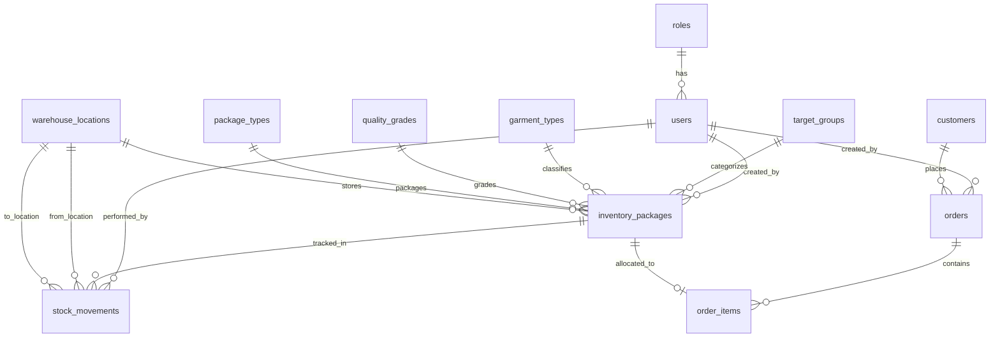

# Product Requirements Document (PRD) — ReWear WMS (`due-prog-03`)

**Project Name:** ReWear WMS (`due-prog-03`)  
**Course:** Dunaújvárosi Egyetem — Programozás III (Java GUI Projektfeladat)  
**Target Artifact:** Cross-platform runnable `.jar` + NetBeans/Maven project + Hungarian university documentation (`Projektterv`, `Adatbázisterv`, `Programterv`) + 10-minute presentation demo  

---

## 1. Executive Summary

**ReWear WMS** is a desktop Java GUI warehouse and inventory management application built for **used and sorted second-hand clothing packaged goods** (bales, bags, boxes, pallets).

Every sorted package receives a deterministic, human-readable, and machine-scannable **structured QR product code** that encodes its arrival timestamp, target group, garment type, quality grade, package type, weight, and a random 2-digit hexadecimal uniqueness suffix. Operators can generate and preview thermal/sheet QR labels, print them to system printers or PDF, scan physical or image-based QR codes to inspect/move/dispatch stock, manage B2B customer orders, and view real-time warehouse analytics — all in a modern **bilingual (English & Hungarian) CSV-driven UI** backed by a normalized **embedded SQLite database**.

The design intentionally balances **high grading-rubric value** (3NF database, RBAC security, QR generation & scanning, print preview & physical printing, PDF/CSV file handling, interactive charts, CSV i18n) with **conceptual simplicity** so the entire system can be clearly understood and demonstrated in a 10-minute presentation.

---

## 2. Alignment with Grading Criteria & Deliverables

| Rubric Criterion | How ReWear WMS Addresses It |
|---|---|
| **a) Complexity** | End-to-end warehouse lifecycle: Intake → QR Label Print → Shelf Storage → QR Scan Operations → B2B Order Dispatch → Audit Trail & Analytics. |
| **b) Database & Normalization** | 12-table 3NF SQLite relational schema with `1:N` and `M:N`-style join structures, foreign key enforcement, check constraints, transactions, and lookup tables mirroring the QR code structure. |
| **c) Program Design** | Clean Layered/MVC architecture (`ui`, `service`, `dao`, `model`, `util`, `i18n`), documented with UML Class, Use-Case, and ER diagrams. |
| **d) Quality & Design** | Modern Swing UI styled with **FlatLaf** (Light & Dark themes), responsive layouts, form validation, clear status badges, and intuitive navigation. |
| **e) Technology Diversity** | Java Swing + FlatLaf, JDBC + SQLite, BCrypt auth, **ZXing** QR code generation & decoding, Java Print API (`PrinterJob`) + Print Preview canvas, **OpenPDF** reports/labels, **XChart** analytics, **CSV-driven multi-language i18n**, CSV export, DB backup/restore, SLF4J logging, JUnit 5 tests. |
| **f) Deliverables** | Maven project (opens in NetBeans/IntelliJ/VS Code), runnable fat `.jar`, `Projektterv`, `Adatbázisterv`, `Programterv` (UML & Use-Case), bundled into final `.zip`. |

---

## 3. Structured QR Product Code Specification

Every package entered into the system is assigned a unique code embedded directly into its QR label:

```text
YYYY-MM-DD-HH-MM-<WHATFOR>-<TYPE>-<QUALITY>-<PACKAGETYPE>-<WEIGHT>-<HEX2>
```

### Example
`2026-11-12-11-23-L-TSH-A-A-25-3F`

| Position | Segment | Example | Description | Source |
|---|---|---|---|---|
| 1–5 | `YYYY-MM-DD-HH-MM` | `2026-11-12-11-23` | Entry date & time (local warehouse time) | System clock (editable only by Admin/Manager if needed) |
| 6 | `WHATFOR` | `L` | Target demographic / category (`L` Ladies, `M` Men, `K` Kids, `B` Baby, `U` Unisex, `H` Home Textiles) | `target_groups.code` |
| 7 | `TYPE` | `TSH` | Garment / item type (`TSH` T-Shirts, `JNS` Jeans, `JKT` Jackets, `DRS` Dresses, `SWT` Sweaters, `SHO` Shoes, `MIX` Mixed) | `garment_types.code` |
| 8 | `QUALITY` | `A` | Sorted quality grade (`CR` Cream/Extra, `A` Grade A, `B` Grade B, `C` Grade C / Rags) | `quality_grades.code` |
| 9 | `PACKAGETYPE` | `A` | Packaging form (`A` Compressed Bale, `B` Clear Bag, `C` Cardboard Box, `P` Pallet) | `package_types.code` |
| 10 | `WEIGHT` | `25` | Net weight in whole kg (e.g. `25`, `50`, `100`; integer or formatted decimal without hyphens) | User input |
| 11 | `HEX2` | `3F` | Random 2-digit uppercase hexadecimal suffix (`00`–`FF`) ensuring uniqueness per item | Auto-generated (`SecureRandom`), verified unique against DB (regenerated if collision occurs) |

### Parsing & Validation Rules
- A dedicated `ProductCodeService` handles both **generation** and **regex-based parsing**.
- When any QR code is scanned, the app:
  1. Validates syntax against the structured pattern.
  2. Looks up the exact record in `inventory_packages` by `qr_code`.
  3. Also displays the human-readable decoded breakdown (even if inspecting an external/unregistered code matching the format, flagging it clearly as *"Valid format — not found in local database"*).

---

## 4. CSV-Based Internationalization (i18n) System

All user-facing UI text (labels, buttons, menus, table headers, dialog messages, validation errors, status badges, printed ticket labels) MUST be loaded from a single UTF-8 CSV translation file so new languages can be added in the future without recompiling Java code.

### File Structure (`src/main/resources/i18n/translations.csv` + optional external override `data/translations.csv`)
```csv
key,en,hu
app.title,ReWear WMS — Second-Hand Clothing Warehouse,ReWear WMS — Használt Ruha Raktárkezelő
login.username,Username,Felhasználónév
login.password,Password,Jelszó
login.button,Sign In,Bejelentkezés
nav.dashboard,Dashboard,Áttekintés
...
```

### i18n Requirements
- **Dynamic Language Discovery:** On startup, `I18nManager` reads the CSV header row (`key,<lang1>,<lang2>,...`) so adding a new column (e.g. `de` or `sk`) automatically exposes that language in the UI language selector.
- **RFC-4180 Compliant Parsing:** Properly handles quoted fields, commas inside text, escaped quotes, and UTF-8 Hungarian accented characters (`áéíóöőúüű`).
- **Live Switching:** Changing language in the top toolbar updates active UI labels (via listener pattern or clean view refresh) and persists the preferred language in `app_settings` / local properties.
- **Fallback Behavior:** If a key is missing in the selected language, fall back to `en`; if missing completely, render `[key]` and log a warning so untranslated strings are caught immediately.
- **External Override / Export:** Admin can export the active `translations.csv` or reload an edited CSV file at runtime.

---

## 5. User Roles & Permissions (RBAC)

Authentication uses username + password stored as **BCrypt hashes** (never plaintext).

| Capability | `ADMIN` | `MANAGER` | `OPERATOR` |
|---|:---:|:---:|:---:|
| Login / Change Own Password / Switch Language & Theme | Yes | Yes | Yes |
| View Dashboard & Charts | Yes | Yes | Yes |
| Package Intake (Create Package, Generate & Print QR Label) | Yes | Yes | Yes |
| QR Scanner Station (Inspect, Relocate, Stocktake Verify) | Yes | Yes | Yes |
| Browse & Search Inventory | Yes | Yes | Yes |
| Create / Pack / Ship Customer Orders (via Scan or Select) | Yes | Yes | View Only |
| Export PDF Delivery Notes & CSV Reports | Yes | Yes | Label PDF Only |
| Manage Customers & Warehouse Locations | Yes | Yes | No |
| Manage QR Code Dictionaries (Target, Type, Quality, Packaging) | Yes | Yes | No |
| User & Role Management, DB Backup/Restore, Audit Log Export | Yes | No | No |

---

## 6. Functional Modules & User Flows

### 6.1 Login & Application Shell
- Clean login window with username, password, language switcher (`EN` / `HU`), and theme toggle (Light / Dark).
- Pre-seeded demo accounts (clearly shown in README & demo script, e.g., `admin`, `manager`, `operator`).
- Main window uses a modern left sidebar navigation + top status bar (logged-in user, role badge, language selector, Light/Dark toggle, quick "Scan QR" shortcut, Logout).

### 6.2 Dashboard & Visual Analytics
- **KPI Summary Cards:** Total Packages in Stock, Total Stock Weight (kg), Today's Intake (packages & kg), Open Orders.
- **Interactive Charts (XChart):**
  1. Stock Weight (kg) by **Quality Grade** (Pie / Donut chart).
  2. Stock Weight (kg) by **Garment Type** (Bar chart).
  3. Recent **Intake vs. Shipped Weight** trend (Bar/Line chart).
- **Recent Activity Feed:** Latest `stock_movements` entries.

### 6.3 Package Intake & Live QR Generator
- Form inputs: Target Group, Garment Type, Quality Grade, Package Type, Weight (kg), Warehouse Location (shows remaining capacity), optional Notes, Quantity of labels/bales to create (1 or batch N).
- **Live Preview Card:** Automatically computes and displays the generated code (`YYYY-MM-DD-HH-MM-...-XX`) and live **ZXing QR Code image** as fields change.
- Actions: **Save & Open Print Preview**, **Save Only**, **Regenerate Hex Suffix**.
- Automatically writes an `INTAKE` record to `stock_movements` in the same DB transaction.

### 6.4 Ticket / Label Print Preview & Printer Integration
- Dedicated **Print Preview Dialog** rendering the exact print output on a zoomable vector/high-DPI `JPanel` canvas:
  - **Paper / Ticket Presets:**
    - Thermal Label `100 × 150 mm` (standard logistics/bale sticker)
    - Compact Thermal `80 × 100 mm`
    - `A6` Card
    - `A4 Sheet (4-up)` for printing multiple selected labels on office paper
  - **Ticket Content:** Warehouse header, large high-contrast QR code, full monospace code string, decoded human-readable grid (Target, Type, Quality, Packaging, Weight in bold large font), Warehouse Location badge, Entry Timestamp, Operator name.
  - **Controls:** Layout preset selector, Zoom slider (`50%`–`200%`), Copies count, System Printer dropdown (`PrintServiceLookup`), **"Print..."** (`java.awt.print.PrinterJob`), **"Save as PDF"** (OpenPDF), and **"Save QR as PNG"** (handy for testing/demoing image scan!).

### 6.5 QR Scanner Station (Hardware + Demo-Safe)
Designed for both **real warehouse scanners** and **classroom presentation demos**:
1. **USB / Bluetooth HID Scanner Mode (Always Ready):**
   - Focused scan input field captures rapid keyboard-wedge scanner input ending with `Enter`.
   - Visual audio/color feedback (green beep/flash on found, amber on warning, red on invalid/not found).
2. **Scan from Image / File Mode (ZXing Decoder):**
   - Load or drag-and-drop a saved label PNG/JPG (or exported label image) to decode the QR code automatically — guarantees a flawless live demo without external hardware.
3. **Quick-Pick Demo Scanner (Optional helper for testing):**
   - Allows copying/injecting an existing package QR code into the scanner pipeline to test workflows quickly.
4. **Post-Scan Instant Actions:**
   - Displays full package card (decoded specs, current status, shelf location, history).
   - **Quick Relocate:** Move package to another warehouse location (logs `RELOCATE` movement).
   - **Verify / Stocktake:** Mark package as verified today (logs `SCAN_VERIFY`).
   - **Reprint Ticket:** Opens Print Preview directly.
   - **Add to Active Order:** Reserves & attaches the scanned bale to an open customer order (logs `RESERVE`).

### 6.6 Inventory Browser & Warehouse Locations
- Searchable, sortable `JTable` of all packages with filters: QR Code search, Status, Target Group, Garment Type, Quality Grade, Package Type, Location, Date Range.
- Bulk selection → **Batch Print Preview (A4 4-up)** or **Export Filtered View to CSV**.
- **Warehouse Locations Panel:** Manage racks/zones (`A-01-01`, etc.) with visual occupancy progress bar (`current_kg / max_capacity_kg`).

### 6.7 Customers, Orders & Dispatch
- Manage B2B customers (company name, contact person, email, phone, address, tax ID).
- Create an Order → Add bales via **QR Scan** or **Inventory Picker** (only `IN_STOCK` packages allowed; price/kg defaults from `quality_grades.default_price_per_kg`, editable per line).
- Order lifecycle: `DRAFT` → `PACKING` (packages marked `RESERVED`) → `SHIPPED` (packages marked `SHIPPED`, `SHIP` movements logged) or `CANCELLED` (packages released back to `IN_STOCK`).
- Generate **PDF Delivery Note / Packing List** (OpenPDF) listing every bale's QR code, category breakdown, weight, unit price, total kg, and grand total.

### 6.8 Admin: Code Dictionaries, Users & Maintenance
- **Dictionaries Tab:** Add/Edit/Deactivate `target_groups`, `garment_types`, `quality_grades`, `package_types` (prevents deleting codes referenced by existing packages).
- **Users Tab:** Create users, assign roles, reset passwords, activate/deactivate accounts.
- **Maintenance Tab:** One-click **SQLite DB Backup** (`.db` copy with timestamp), **Restore from Backup**, **Export Translations CSV**, and **Reload Translations CSV**.

---

## 7. Relational Database Design (3NF SQLite Schema)

SQLite runs with `PRAGMA foreign_keys = ON;`.



### Table Summary (12 Tables)
1. `roles` (`id`, `code` UNIQUE, `name`)
2. `users` (`id`, `username` UNIQUE, `password_hash`, `full_name`, `role_id` FK, `active`, `created_at`)
3. `target_groups` (`id`, `code` UNIQUE, `name_en`, `name_hu`, `active`)
4. `garment_types` (`id`, `code` UNIQUE, `name_en`, `name_hu`, `active`)
5. `quality_grades` (`id`, `code` UNIQUE, `name_en`, `name_hu`, `default_price_per_kg`, `active`)
6. `package_types` (`id`, `code` UNIQUE, `name_en`, `name_hu`, `tare_weight_kg`, `max_weight_kg`, `active`)
7. `warehouse_locations` (`id`, `code` UNIQUE, `zone`, `aisle`, `shelf`, `max_capacity_kg`, `active`)
8. `inventory_packages` (`id`, `qr_code` UNIQUE, `target_group_id` FK, `garment_type_id` FK, `quality_grade_id` FK, `package_type_id` FK, `location_id` FK, `weight_kg`, `hex_suffix`, `status`, `notes`, `created_by` FK, `created_at`, `updated_at`)
9. `customers` (`id`, `name`, `contact_name`, `email`, `phone`, `address`, `tax_number`, `active`, `created_at`)
10. `orders` (`id`, `order_number` UNIQUE, `customer_id` FK, `status`, `total_weight_kg`, `total_price`, `notes`, `created_by` FK, `created_at`, `shipped_at`)
11. `order_items` (`id`, `order_id` FK, `package_id` FK, `price_per_kg`, `line_total`)
12. `stock_movements` (`id`, `package_id` FK, `movement_type`, `from_location_id` FK nullable, `to_location_id` FK nullable, `user_id` FK, `note`, `created_at`)

*(Note: Dictionary tables include `name_en` and `name_hu` so even dynamic database values display cleanly in both English and Hungarian!)*

---

## 8. Technology Stack & Architecture

- **Language:** Java 17 LTS (broadly compatible with NetBeans, macOS, Windows, Linux)
- **Build & Packaging:** Apache Maven + `maven-shade-plugin` → single self-contained runnable `due-prog-03.jar`
- **GUI Framework:** Java Swing + **FlatLaf** (FlatLightLaf / FlatDarkLaf)
- **Database:** Embedded **SQLite** via `sqlite-jdbc` (auto-initialized schema + rich realistic demo seed data on first run)
- **QR Code Engine:** **Google ZXing** (`core` + `javase`) for generating & decoding QR codes
- **Printing:** Java Standard Print API (`java.awt.print.Printable`, `PrinterJob`, `PrintServiceLookup`)
- **PDF Generation:** **OpenPDF** (labels & B2B delivery notes / packing lists)
- **Charts:** **XChart** (clean lightweight Swing-embeddable charts)
- **Security:** **jBCrypt** password hashing
- **Logging:** **SLF4J + Logback**
- **Testing:** **JUnit 5** (unit tests for product code generator/parser, CSV i18n loader, DAOs, and service logic)

### Package Architecture
```text
hu.due.rewear
├── App.java                 # Entry point, FlatLaf init, DB bootstrap, Login launch
├── config/                  # AppConfig, DatabaseManager, SchemaInitializer, DemoDataSeeder
├── i18n/                    # I18nManager, CsvTranslationLoader, LanguageChangeListener
├── model/                   # Domain POJOs & Enums (InventoryPackage, Order, User, Role, etc.)
├── dao/                     # JDBC Data Access Objects (Repository layer)
├── service/                 # Business logic (AuthService, ProductCodeService, QrService,
│                            #   InventoryService, OrderService, PrintService, ExportService, BackupService)
└── ui/                      # Swing Frames, Panels, Dialogs, PrintPreviewPanel, Custom TableModels
```

---

## 9. University Documentation & Presentation Deliverables

Stored in `docs/`:
1. `docs/Projektterv.md` (and PDF export) — Project description, goals, participants, project lead, schedule, technology choices (Hungarian).
2. `docs/Adatbazisterv.md` (and PDF export) — ER diagram (Mermaid/PNG), table definitions, keys, relationships, normalization justification 1NF→3NF (Hungarian).
3. `docs/Programterv.md` (and PDF export) — Use-Case diagram, UML Class diagram, Architecture & key sequence diagrams (Hungarian).
4. `docs/Presentation_Outline_10min.md` — Slide-by-slide 10-minute PPT speaker script & live demo checklist.

---

## 10. Non-Goals / Scope Guardrails (Keeping It Easy to Understand)
- No cloud server, REST backend, or external MySQL server required (embedded SQLite keeps setup zero-friction).
- No financial accounting / NAV invoicing integration (focused on warehouse stock, QR tracking, and packing/delivery notes).
- No webcam dependency required to run the app (hardware HID scanner + image QR decoding work reliably on every OS without native camera driver issues; optional webcam support can be evaluated later only if zero-friction).
