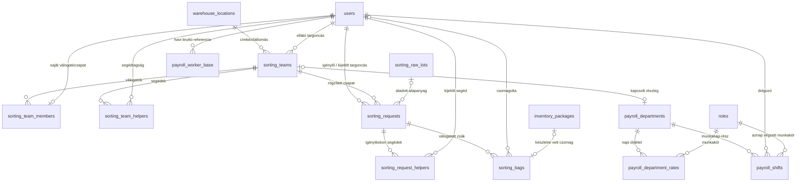

# Adatbázisterv — ReWear WMS (`due-prog-03`)

**Adatbázis-kezelő rendszer:** Beágyazott SQLite 3 (JDBC `sqlite-jdbc`, `PRAGMA foreign_keys = ON`)  
**Séma fájl:** `src/main/resources/db/schema.sql`  
**Séma:** **42 alkalmazástábla**, **24 név szerint deklarált index** és a kulcsmegszorítások SQLite-indexei

---

## 1. Logikai csoportosítás

Az alkalmazástáblák tíz logikai csoportot alkotnak.

1. **Alkalmazás- és pénzügyi törzskonfiguráció (3 tábla):** `app_settings`, `currencies`, `tax_types`
2. **Hitelesítés, szerepkörök és modul-jogosultsági mátrix (3 tábla):** `roles`, `users`, `role_module_permissions`
3. **QR kódtörzsek — dinamikus szótártáblák (4 tábla):** `target_groups`, `garment_types`, `quality_grades`, `package_types` *(közvetlenül leképezik a QR termékkód szegmenseit és az alapértelmezett EUR/HUF kilónkénti árakat)*
4. **Raktárkészlet és mozgásnapló (3 tábla):** `warehouse_locations`, `inventory_packages`, `stock_movements`
5. **B2B partnerek, rendelések, átadás és többdevizás számlázás (8 tábla):** `customers`, `orders`, `order_requested_products`, `order_webshop_references`, `order_items`, `invoices`, `invoice_items`, `invoice_events`
6. **Vállalati kommunikáció, értesítések és teendők (6 tábla):** `emails`, `chat_rooms`, `chat_room_members`, `chat_messages`, `notifications`, `user_todos`
7. **Felhasználónként mentett számla- és e-mail-szűrések (2 tábla):** `smart_folders`, `smart_folder_rules`
8. **Kézi és demó banki nyilvántartás (2 tábla):** `bank_accounts`, `bank_transactions`
9. **Válogatás (7 tábla, nyersanyag-tételekkel):** `sorting_teams`, `sorting_team_members`, `sorting_team_helpers`, `sorting_raw_lots`, `sorting_requests`, `sorting_request_helpers`, `sorting_bags`
10. **Bérszámfejtési előkészítés (4 tábla):** `payroll_departments`, `payroll_worker_base`, `payroll_department_rates`, `payroll_shifts`

---

## 2. Egyed-kapcsolat (ER) diagram

```mermaid
erDiagram
    roles ||--o{ users : "szerepkör (1:N)"
    roles ||--o{ role_module_permissions : "modul szabály (1:N)"
    warehouse_locations ||--o{ users : "kijelölt állomás (0..N)"

    users ||--o{ inventory_packages : "rögzítette (1:N)"
    users ||--o{ orders : "létrehozta / targoncás (1:N)"
    users ||--o{ stock_movements : "végrehajtotta (1:N)"
    users ||--o{ invoices : "kiállította (1:N)"

    target_groups ||--o{ inventory_packages : "célcsoport (1:N)"
    garment_types ||--o{ inventory_packages : "terméktípus (1:N)"
    quality_grades ||--o{ inventory_packages : "minőség (1:N)"
    package_types ||--o{ inventory_packages : "csomagolás (1:N)"
    warehouse_locations ||--o{ inventory_packages : "tárolási hely (1:N)"

    inventory_packages ||--o{ stock_movements : "mozgástörténet (1:N)"
    warehouse_locations ||--o{ stock_movements : "honnan / hová (0..N)"

    customers ||--o{ orders : "megrendeli (1:N)"
    warehouse_locations ||--o{ orders : "kiadó zóna (0..N)"
    orders ||--o{ order_requested_products : "termékigény"
    orders ||--o| order_webshop_references : "webshop hivatkozás"
    orders ||--o{ order_items : "tételei (1:N)"
    inventory_packages ||--o{ order_items : "kiosztva (1:N)"

    orders ||--o{ invoices : "számlázva (0..N)"
    customers ||--o{ invoices : "partner (0..N)"
    invoices ||--o{ invoice_items : "számlasorok (1:N)"
    invoices ||--o{ invoice_events : "életciklus-események (1:N)"
    invoices |o--o| invoices : "jóváíró számla az eredetihez (0..1)"
    users ||--o{ invoice_events : "végrehajtotta (0..N)"
    currencies ||--o{ bank_accounts : "számladeviza (1:N)"
    bank_accounts ||--o{ bank_transactions : "számlatörténet (1:N)"

    users ||--o{ emails : "postafiók (1:N)"
    users ||--o{ chat_rooms : "létrehozta (1:N)"
    chat_rooms ||--o{ chat_room_members : "résztvevők (1:N)"
    users ||--o{ chat_room_members : "tagság (1:N)"
    chat_rooms ||--o{ chat_messages : "üzenetek (1:N)"
    users ||--o{ chat_messages : "küldő (1:N)"
    users ||--o{ notifications : "címzett (1:N)"
    users ||--o{ user_todos : "saját teendők (1:N)"
    users ||--o{ smart_folders : "mentett nézet (1:N)"
    smart_folders ||--o{ smart_folder_rules : "szűrési feltétel (1:N)"
```

A válogatás és a bérszámfejtési előkészítés legfontosabb kapcsolatai külön ábrán szerepelnek.

---

## 3. Táblák részletes definíciója

### 3.1 `app_settings` (Hordozható alkalmazás-, cégprofil- és levelezési beállítások)
| Oszlop | Típus | Megszorítások | Leírás |
|---|---|---|---|
| `setting_key` | `TEXT` | `PRIMARY KEY` | Kulcs (pl. `company.name`, `company.iban.EUR`, `mail.domain`, `mail.smtp.host`, `ui.language`, `ui.theme`) |
| `setting_value` | `TEXT` | `NOT NULL` | Beállítás értéke (hordozhatóan, a `.db` fájlban tárolva) |

**Eladói cím és IBAN:** A `company.address.street`, `company.address.city` és `company.address.postal_code` külön tárolja a cím elemeit. A korábbi `company.address` mező beolvasáskor tartalék adatforrás. A `company.iban.<DEVIZA>` üres értéke törli az adott deviza IBAN-ját, az alapértelmezett számlaszámot is felülírva.

**NAV demó:** A `nav.demo.*` kulcsok a környezetet és a szimuláció beállításait tárolják. A jelszó, az aláírókulcs és a cserekulcs nem kerül a fájlba.

**Banki nyilvántartás:** A `bank_accounts` a bankot, számlanevet, IBAN-t vagy számlaszámot, BIC-et, devizát, nyitó dátumot és egyenleget tárolja. A `bank_transactions` számlánként rögzíti a könyvelési dátumot, előjeles összeget, partnert és közleményt. Az összegek decimális szövegként tárolódnak. A `(bank_name, account_reference, currency)` kombináció egyedi. Az `idx_bank_transactions_account_date` a történet lekérdezését gyorsítja.

### 3.2 `currencies` (Konfigurálható devizák)
| Oszlop | Típus | Megszorítások | Leírás |
|---|---|---|---|
| `id` | `INTEGER` | `PRIMARY KEY AUTOINCREMENT` | Egyedi azonosító |
| `code` | `TEXT` | `NOT NULL UNIQUE` | ISO devizakód (pl. `EUR`, `HUF`, `USD`, `GBP`) |
| `name_en`, `name_hu` | `TEXT` | `NOT NULL` | Angol és magyar megnevezés |
| `symbol` | `TEXT` | `NOT NULL` | Megjelenített jelölés (`€`, `Ft`, `$`) |
| `decimal_places` | `INTEGER` | `NOT NULL DEFAULT 2 CHECK (0,2)` | Tizedesjegyek száma (`0` HUF-hoz, `2` EUR/USD-hoz) |
| `active` | `INTEGER` | `NOT NULL DEFAULT 1 CHECK (0,1)` | Aktív státusz |

### 3.3 `tax_types` (Konfigurálható ÁFA / adókulcs típusok)
| Oszlop | Típus | Megszorítások | Leírás |
|---|---|---|---|
| `id` | `INTEGER` | `PRIMARY KEY AUTOINCREMENT` | Egyedi azonosító |
| `code` | `TEXT` | `NOT NULL UNIQUE` | Rövid kód (pl. `HU-27`, `EU-0`, `EXPORT-0`, `AAM-0`) |
| `name_en`, `name_hu` | `TEXT` | `NOT NULL` | Angol és magyar megnevezés |
| `rate_percent` | `REAL` | `NOT NULL DEFAULT 0 CHECK (>= 0)` | Adókulcs százalékban (`27`, `0`, `18`, `5`) |
| `country_scope` | `TEXT` | `CHECK ('HU','EU','NON_EU','ANY')` | Automatikus partner-ország szerinti ajánlási hatókör |
| `active` | `INTEGER` | `NOT NULL DEFAULT 1 CHECK (0,1)` | Aktív státusz |

### 3.4 `roles` (Jogosultsági szerepkörök)
| Oszlop | Típus | Megszorítások | Leírás |
|---|---|---|---|
| `id` | `INTEGER` | `PRIMARY KEY AUTOINCREMENT` | Egyedi azonosító |
| `code` | `TEXT` | `NOT NULL UNIQUE` | Szerepkör kód (`SUPER_ADMIN`, `ADMIN`, `MANAGER`, `OPERATOR`, `SORTER`, `SORTING_HELPER`, `FORKLIFT`). A hét szerepkört a séma hozza létre minden telepítésben, nem a demó adat. |
| `name` | `TEXT` | `NOT NULL` | Megnevezés |

### 3.5 `users` (Felhasználók)
| Oszlop | Típus | Megszorítások | Leírás |
|---|---|---|---|
| `id` | `INTEGER` | `PRIMARY KEY AUTOINCREMENT` | Egyedi azonosító |
| `username` | `TEXT` | `NOT NULL UNIQUE` | Bejelentkezési név |
| `password_hash` | `TEXT` | `NOT NULL` | BCrypt hash (soha nem nyílt szöveg) |
| `full_name`, `last_name`, `first_name` | `TEXT` | `full_name NOT NULL` | Teljes név, vezetéknév és keresztnév |
| `email`, `phone` | `TEXT` | `NULL` | Vállalati e-mail (`keresztnev.vezeteknev@domain`) és telefon |
| `avatar_png` | `BLOB` | `NULL` | Opcionális profilkép PNG bájtok |
| `role_id` | `INTEGER` | `NOT NULL FK -> roles(id)` | Szerepkör hivatkozás |
| `assigned_station_id` | `INTEGER` | `NULL FK -> warehouse_locations(id)` | Operátorhoz rendelt `OPERATOR_STATION` állomás (pl. `ST-OP-01`) |
| `active` | `INTEGER` | `NOT NULL DEFAULT 1 CHECK (0,1)` | Aktív státusz |
| `created_at` | `TEXT` | `NOT NULL` | Létrehozás időpontja (`yyyy-MM-dd HH:mm:ss`) |

### 3.6 `role_module_permissions` (Szuper Admin Szerepkör × Modul jogosultsági mátrix)
| Oszlop | Típus | Megszorítások | Leírás |
|---|---|---|---|
| `role_id` | `INTEGER` | `NOT NULL FK -> roles(id) ON DELETE CASCADE` | Szerepkör hivatkozás (összetett PK része) |
| `module_code` | `TEXT` | `NOT NULL` | `AppModule` modul kódja (`DASHBOARD`, `TODO`, `PUTAWAY`, `STAGING`, `EMAIL`, ...) |
| `enabled` | `INTEGER` | `NOT NULL DEFAULT 1` | Engedélyezve (`1`) / kikapcsolva (`0`) |
| `updated_at` | `TEXT` | `NOT NULL` | Utolsó módosítás időbélyege |
| *(összetett)* | `PRIMARY KEY` | `PRIMARY KEY (role_id, module_code)` | Szerepkörönként és modulonként egyetlen szabály |

### 3.7–3.10 QR Kódtörzsek (`target_groups`, `garment_types`, `quality_grades`, `package_types`)
- **`target_groups`:** `id`, `code` (`UNIQUE`), `name_en`, `name_hu`, `active` *(QR `WHATFOR` szegmens)*
- **`garment_types`:** `id`, `code` (`UNIQUE`), `name_en`, `name_hu`, `price_eur_per_kg`, `price_huf_per_kg`, `active` *(QR `TYPE` szegmens)*
- **`quality_grades`:** `id`, `code` (`UNIQUE`), `name_en`, `name_hu`, `default_price_per_kg`, `default_price_huf_per_kg`, `active` *(QR `QUALITY` szegmens)*
- **`package_types`:** `id`, `code` (`UNIQUE`), `name_en`, `name_hu`, `tare_weight_kg`, `max_weight_kg`, `active` *(QR `PACKAGETYPE` szegmens)*

### 3.11 `warehouse_locations` (Típusozott raktárhelyek és állomások)
| Oszlop | Típus | Megszorítások | Leírás |
|---|---|---|---|
| `id` | `INTEGER` | `PRIMARY KEY AUTOINCREMENT` | Egyedi azonosító |
| `code` | `TEXT` | `NOT NULL UNIQUE` | Helykód (pl. `ST-OP-01`, `A-01-01`, `DOCK-01`) |
| `location_type` | `TEXT` | `CHECK ('OPERATOR_STATION','STORAGE','DISPATCH_ZONE')` | Operátori állomás / Tárolópolc / Kiadó gyűjtőzóna |
| `zone`, `aisle`, `shelf` | `TEXT` | `NOT NULL` | Zóna, sor, polc bontás |
| `max_capacity_kg` | `REAL` | `NOT NULL CHECK (> 0)` | Teherbírás (kg) |
| `active` | `INTEGER` | `NOT NULL DEFAULT 1 CHECK (0,1)` | Aktív státusz |

### 3.12 `inventory_packages` (Központi csomag/bála készlet)
| Oszlop | Típus | Megszorítások | Leírás |
|---|---|---|---|
| `id` | `INTEGER` | `PRIMARY KEY AUTOINCREMENT` | Egyedi azonosító |
| `qr_code` | `TEXT` | `NOT NULL UNIQUE` | Teljes strukturált QR termékkód |
| `target_group_id`, `garment_type_id`, `quality_grade_id`, `package_type_id`, `location_id` | `INTEGER` | `NOT NULL FK` | Hivatkozások a kódtörzsekre és aktuális raktárhelyre |
| `weight_kg` | `REAL` | `NOT NULL CHECK (> 0)` | Nettó súly (kg) |
| `hex_suffix` | `TEXT` | `NOT NULL CHECK (length = 2)` | Véletlen 2 jegyű hexadecimális azonosító |
| `status` | `TEXT` | `CHECK ('IN_STOCK','RESERVED','SHIPPED','DISCARDED')` | Életciklus-állapot |
| `notes` | `TEXT` | `NULL` | Opcionális megjegyzés |
| `created_by` | `INTEGER` | `NOT NULL FK -> users(id)` | Rögzítő felhasználó |
| `created_at`, `updated_at` | `TEXT` | `NOT NULL` | Időbélyegek |

### 3.13 `stock_movements` (Készletmozgás audit napló)
- `id`, `package_id` (`FK`), `movement_type` (`INTAKE`, `RELOCATE`, `SCAN_VERIFY`, `RESERVE`, `RELEASE`, `SHIP`, `DISCARD`), `from_location_id` (`FK`), `to_location_id` (`FK`), `user_id` (`FK`), `note`, `created_at`.

### 3.14 `customers` (B2B üzleti partnerek — Vevők és Beszállítók)
- `id`, `name`, `partner_type` (`CUSTOMER`, `SUPPLIER`, `BOTH`), `contact_name`, `email`, `phone`, `address`, `tax_number`, `country_code`, `preferred_currency`, `active`, `created_at`.

### 3.15 `orders` (Vevői rendelések — targoncás és gyűjtőzóna-hozzárendeléssel)
| Oszlop | Típus | Megszorítások | Leírás |
|---|---|---|---|
| `id` | `INTEGER` | `PRIMARY KEY AUTOINCREMENT` | Egyedi azonosító |
| `order_number` | `TEXT` | `NOT NULL UNIQUE` | Sorszám (pl. `ORD-2026-0001`) |
| `customer_id` | `INTEGER` | `NOT NULL FK -> customers(id)` | Megrendelő partner |
| `status` | `TEXT` | `CHECK ('DRAFT','PACKING','SHIPPED','CANCELLED')` | Rendelés állapota |
| `currency` | `TEXT` | `NOT NULL DEFAULT 'EUR'` | Rendelés devizája |
| `total_weight_kg`, `total_price` | `REAL` | `NOT NULL DEFAULT 0 CHECK (>= 0)` | Összesített súly és végösszeg |
| `assigned_forklift_id` | `INTEGER` | `NULL FK -> users(id)` | Kijelölt targoncás felhasználó |
| `dispatch_location_id` | `INTEGER` | `NULL FK -> warehouse_locations(id)` | Kijelölt kiadó gyűjtőzóna (pl. `DOCK-01`) |
| `customer_arrived_at` | `TEXT` | `NULL` | Vevő megérkezésének időpontja (riasztáshoz és átadáshoz) |
| `delivery_date` | `TEXT` | `NULL` | Ütemezett átadási nap ISO-dátummal. A korábbi rendelés dátuma hiányozhat. |
| `notes`, `created_by`, `created_at`, `shipped_at` | `TEXT / INTEGER` | `created_by FK` | Megjegyzés, létrehozó, időbélyegek |

### 3.16 `order_items` (Rendelési tételek — átadás-ellenőrzéssel)
- `id`, `order_id` (`FK CASCADE`), `package_id` (`FK`), `price_per_kg`, `line_total`, `handover_scanned` (`INTEGER DEFAULT 0` — raktárvezetői QR-átadás ellenőrzés), `UNIQUE(order_id, package_id)`.

### 3.17–3.18 `invoices` és `invoice_items` (Többdevizás számlázás és bizonylattár)
- **`invoices`:** `id`, `invoice_number` (`UNIQUE`), `direction` (`OUTGOING`/`INCOMING`), `category`, `order_id` (`FK`), `customer_id` (`FK`), partner pillanatfelvétel (`partner_name`, `partner_tax_number`, `partner_address`, `partner_email`), `status` (`DRAFT`, `ISSUED`, `PAID`, `OVERDUE`, `CANCELLED`), `issue_date`, `due_date`, `paid_date`, `net_amount`, `vat_rate`, `vat_amount`, `gross_amount`, `tax_type_code`, `currency`, `exchange_rate`, `attachment_path` (`./data/receipts/` mappához viszonyítva), `archived_pdf_path` (`./data/invoices/` mappához viszonyítva), `credit_for_invoice_id` (`FK -> invoices(id) ON DELETE SET NULL`: a jóváíró számla eredeti számlája, egyébként `NULL`), `created_by` (`FK`), `created_at`.
- **Állapotváltás:** a `status` kézi módosítását az `InvoiceLifecycle` szabályozza. Megengedett: `DRAFT → ISSUED`, `ISSUED`/`OVERDUE → PAID`, `PAID → ISSUED`. Kiállítás után a számla nem lesz újra `DRAFT`, `CANCELLED` csak jóváíró számlával keletkezik és végleges, az `OVERDUE` a lejárati dátumból automatikus, a jóváíró számla állapota pedig nem módosítható. A `credit_for_invoice_id` az ismételt jóváírás elleni védelem alapja; a korábbi, csak szöveges hivatkozású jóváíró számlákat az indítás egyszer összekapcsolja az eredetivel.
- **`invoice_items`:** `id`, `invoice_id` (`FK CASCADE`), `description`, `quantity`, `unit`, `unit_price`, `line_net`.

### 3.19 `emails` (Vállalati postafiók üzenetek)
| Oszlop | Típus | Megszorítások | Leírás |
|---|---|---|---|
| `id` | `INTEGER` | `PRIMARY KEY AUTOINCREMENT` | Egyedi azonosító |
| `owner_user_id` | `INTEGER` | `NOT NULL FK -> users(id) ON DELETE CASCADE` | Postafiók tulajdonosa |
| `folder` | `TEXT` | `CHECK ('INBOX','SENT','DRAFTS','TRASH')` | Mappa |
| `from_address`, `to_addresses`, `cc_addresses`, `subject`, `body` | `TEXT` | `NOT NULL` | Levél fejléc és törzs |
| `attachment_path` | `TEXT` | `NULL` | Opcionális csatolmány. Új levélnél a `data/mail-attachments/ÉÉÉÉ/HH/` mappához viszonyított útvonal (a küldött és a kapott példány ugyanazt a fájlt használja); a korábbi, abszolút útvonalak továbbra is megnyithatók |
| `is_read` | `INTEGER` | `NOT NULL DEFAULT 0 CHECK (0,1)` | Olvasott / olvasatlan jelző |
| `is_external` | `INTEGER` | `NOT NULL DEFAULT 0 CHECK (0,1)` | Külső (szimulált SMTP/IMAP) vagy belső levél |
| `delivery_status` | `TEXT` | `NOT NULL DEFAULT 'DELIVERED'` | Belső kézbesítés vagy szimulált külső SMTP-/IMAP-kézbesítés állapota |
| `created_at` | `TEXT` | `NOT NULL` | Időbélyeg |

### 3.20–3.22 Element-stílusú belső chat (`chat_rooms`, `chat_room_members`, `chat_messages`)
- **`chat_rooms`:** `id`, `name`, `room_type` (`ROOM`/`DIRECT`), `topic`, `created_by` (`FK -> users(id)`), `created_at`.
- **`chat_room_members`:** `room_id` (`FK CASCADE`), `user_id` (`FK CASCADE`), `last_read_at`, `PRIMARY KEY (room_id, user_id)`.
- **`chat_messages`:** `id`, `room_id` (`FK CASCADE`), `sender_id` (`FK -> users(id)`), `body`, `created_at`.

### 3.23 `notifications` (Automatikus munkafolyamat-értesítések)
- `id`, `user_id` (`FK CASCADE`), `category` (az alkalmazás értékei: `PUTAWAY`, `ORDER_STAGING`, `ORDER_READY`, `SYSTEM`; az adatbázis nem korlátozza), `title`, `message`, `target_view` (pl. `putaway`, `staging`, `orders`), `is_read` (`0`/`1`), `created_at`.

### 3.24 `user_todos` (Privát felhasználói teendők)
- `id`, `user_id` (`FK CASCADE`), `title`, `priority` (`HIGH`/`MEDIUM`/`LOW`), `due_date` (opcionális határidő), `completed` (`0`/`1`), `created_at`.

### 3.25 `smart_folders` (Intelligens mappák)
- `id` (`INTEGER PRIMARY KEY AUTOINCREMENT`), `owner_user_id` (`NOT NULL REFERENCES users(id) ON DELETE CASCADE`), `scope` (`INVOICE` vagy `MAIL`), `name` (1–80 karakter), `icon` (ikonazonosító).
- A név egy felhasználó adott nézettípusán belül kis- és nagybetűtől függetlenül egyedi.

### 3.26 `smart_folder_rules` (Intelligens mappák feltételei)
- `folder_id` (`REFERENCES smart_folders(id) ON DELETE CASCADE`), `field` (feltételtípus), `value` (a feltétel egy értéke).
- Összetett elsődleges kulcs: `(folder_id, field, value)`. A mappa és feltételei egy tranzakcióban mentődnek. A találatok forrása az eredeti számla- vagy levéltábla.

### 3.27–3.28 Banki nyilvántartás

- A `bank_accounts` a számlaadatokat, a devizát és a nyitóegyenleget, a `bank_transactions` a könyvelési dátumot és az előjeles tranzakciós összeget tárolja. Az összegek decimális szövegből, `BigDecimal` pontossággal összegezhetők.

### 3.29–3.30 Rendelési igény és webshopforrás

- Az `order_requested_products` a termékkombinációt és a csomagszámot tárolja. A fizikai csomagfoglalás az `order_items` táblába kerül.
- Az `order_webshop_references` rendelésenként egy külső hivatkozást tárol. A forrás és a külső azonosító együtt egyedi.

### 3.31–3.37 Válogatás

- A `sorting_teams` a csapatot, az ellátó targoncást, az állomást és a napi célt tárolja. A két tagsági tábla egy saját csapatot enged válogatónként és több csapattagságot segédenként.
- A `sorting_raw_lots` a beérkezett és elérhető alapanyag súlyát tárolja egész grammban. A `sorting_requests` az igénylést, az átadást, a ténylegesen feldolgozott súlyt és a lezárás napját rögzíti. A `sorting_request_helpers` az igényléskor érvényes segédtagságokat őrzi.
- A `sorting_bags` tartalmazza az osztályozott kimenetet, a csomagolót és a csomagolás napját, valamint a készletbe vett csomagra mutató hivatkozást.

### 3.38–3.41 Bérszámfejtési előkészítés

- A `payroll_departments` részlege opcionálisan egy válogatócsapathoz kapcsolódik. A `payroll_worker_base` dolgozónként és hatálybalépési dátumonként tárol havi bruttó referenciaösszeget.
- A `payroll_department_rates` részleg, munkakör és hatálybalépés alapján ad napi bruttó díjtételt és bónuszalapot. A `payroll_shifts` a tényleges részleget, munkakört, a munkanap arányát és a bónusz jóváhagyását rögzíti. A forintösszegek egészek, a százalékos arányok bázispontban tárolódnak.

### 3.42 `invoice_events` (Számla-életciklus naplója)
| Oszlop | Típus | Megszorítások | Leírás |
|---|---|---|---|
| `id` | `INTEGER` | `PRIMARY KEY AUTOINCREMENT` | Egyedi azonosító |
| `invoice_id` | `INTEGER` | `NOT NULL FK -> invoices(id) ON DELETE CASCADE` | Az érintett számla |
| `event_type` | `TEXT` | `NOT NULL` | `ISSUED`, `PAID`, `PAYMENT_WITHDRAWN`, `CREDIT_NOTE_ISSUED`, `CREDIT_NOTE_FOR` |
| `from_status`, `to_status` | `TEXT` | `NULL` | Állapot a változás előtt és után |
| `note` | `TEXT` | `NULL` | Megjegyzés, jóváírásnál a kapcsolódó számla száma |
| `user_id` | `INTEGER` | `NULL FK -> users(id) ON DELETE SET NULL` | A műveletet végző felhasználó |
| `created_at` | `TEXT` | `NOT NULL` | A művelet időpontja |

Az állapotváltás és a hozzá tartozó esemény ugyanabban a tranzakcióban mentődik, ezért nincs napló nélküli állapotváltás. Az indexe: `idx_invoice_events_invoice`.

---

### 3.31b Nyersanyag-tételek és igénylés (`sorting_raw_lots`, `sorting_requests`)

- **`sorting_raw_lots`:** egy napi begyűjtés a `reference` (egyedi) mellett `material` (mit tartalmaz), `source_area`
  (melyik gyűjtési területről érkezett), `location_id` (`FK -> warehouse_locations`, a betárolás helye; `NULL`
  amíg targoncás be nem tárolta), `received_grams`, `available_grams`, `received_by`, `received_at` mezőkkel.
  A tétel csak betárolás után igényelhető.
- **`sorting_requests`:** a `requested_grams` immár elhagyható (`NULL`), mert a válogató nem súlyt, hanem
  nyersanyag-tételt igényel; a `requested_lot_id` (`FK -> sorting_raw_lots`) tárolja, melyik tételt kérte.
  Az átadott mennyiséget továbbra is a `lot_id` és a `delivered_grams` rögzíti, azt a targoncás méri meg.
  A régebbi, súlyra szóló igénylések változatlanul maradnak, azoknál a targoncás választ tételt átadáskor.

---

## 4. Normalizálás igazolása (1NF → 2NF → 3NF)

- **Első normálforma (1NF):** Minden attribútum atomi értéket tartalmaz (a raktárhely `zone`, `aisle`, `shelf` mezőkre bontott, a rendelési tételek az `order_items`, a számlasorok az `invoice_items`, a chatszoba-tagságok a `chat_room_members`, a modul-szabályok pedig a `role_module_permissions` kapcsolótáblában élnek). Minden tábla rendelkezik egyértelmű elsődleges kulccsal.
- **Második normálforma (2NF):** Minden entitástábla egyoszlopos `id` (vagy `setting_key`) kulccsal bír; az itt felsorolt összetett kulcsú kapcsolótáblák (`chat_room_members(room_id, user_id)` és `role_module_permissions(role_id, module_code)`) minden nem-kulcs attribútuma (`last_read_at`, `enabled`, `updated_at`) a teljes összetett kulcstól függ. A `smart_folder_rules` minden oszlopa az összetett elsődleges kulcs része.
- **Harmadik normálforma (3NF):** Minden nem-kulcs attribútum kizárólag a saját elsődleges kulcsától függ:
  - A csomag tulajdonságai (`target_groups`, `garment_types`, `quality_grades`, `package_types`), szerepkörök (`roles`), devizák (`currencies`) és adókulcsok (`tax_types`) külön törzstáblákba vannak kiszervezve.
  - A raktárhely-foglaltság (`used_weight_kg`) és a készletértékelés (`StockValuation`) nem tárolt redundáns mező, hanem SQL aggregációval számított érték.
  - A `invoices` táblában lévő partneradatok **szándékos számviteli pillanatfelvételt** képeznek a kiállított számla megváltoztathatatlansága érdekében, miközben az élő partnerkapcsolat a `customer_id` külső kulcson keresztül megmarad.
  - Az `invoice_events` tábla szándékosan tárolja az állapotváltás előtti és utáni állapotot (`from_status`, `to_status`): ez naplóbejegyzés, amely a változás pillanatát rögzíti, ezért nem számítható újra a számla aktuális állapotából.

---

## 5. Indexek, tranzakciók és adatbiztonság

- **24 deklarált index:** Gyorsítják a készlet, mozgásnapló, rendelések, számlák, üzenetek, értesítések, teendők, válogatási naplók és banki tranzakciók lekérdezéseit. A `idx_sorting_bag_inventory` egyediséget is biztosít a készlethez kapcsolt válogatott csomagokra, az `idx_invoice_events_invoice` pedig a számlák előzményeit gyorsítja.
- **Tranzakciókezelés:** Minden összetett üzleti művelet (csomagfelvétel + `INTAKE`, kötegelt áthelyezés, targoncás komissiózás, ellenőrzött vevői kiadás + `SHIP`, számla + tételek + jóváíró számla, számlaállapot-váltás + naplóbejegyzés) atomi tranzakcióban fut a `DatabaseManager.runInTransaction(...)` segítségével egyetlen megosztott JDBC kapcsolaton.
- **Kiadás és bizonylatok:** Az összekészítés egy tranzakcióban frissíti a csomag helyét, a mozgásnaplót és a rendelés állapotát. A bizonylattár csak a teljes fájl másolása után cseréli le a számla fájlhivatkozását.
- **Hivatkozási védelem és hordozható mentés:** `PRAGMA foreign_keys = ON` + `DictionaryDao` használat-ellenőrzés; rollback-journal mód + `BackupService` (`VACUUM INTO`) egyetlen hordozható `.db` mentési fájllal és visszaállítás előtti `.db.bak` biztonsági másolattal.
- **Teljes mentés:** az Adminban készített `.zip` mentés az SQLite-pillanatképet és a `data/invoices/`, `data/receipts/`, `data/mail-attachments/` mappák összes fájlját tartalmazza, egy `manifest.txt` pedig minden elem SHA-256 ellenőrző összegét és méretét. Visszaállításkor a program mindent egy átmeneti mappában ellenőriz (a jegyzék teljessége, biztonságos elérési utak, méret, ellenőrző összeg, az adatbázis `PRAGMA integrity_check` vizsgálata), és csak ezután cseréli a mappákat: a régi tartalmat a `data/pre-restore-<idő>-files/` mappába teszi, az adatbázist utolsóként cseréli, hiba esetén pedig a mappamozgatásokat visszavonja. A korábbi, csak `.db` mentés továbbra is visszaállítható, ez csak az adatbázist érinti.
- **Levélcsatolmányok:** a küldött vagy mentett csatolmányt a program a `data/mail-attachments/ÉÉÉÉ/HH/` mappába másolja (engedélyezett típus és fájlfejléc-ellenőrzés után, legfeljebb 25 MB). A fájlt csak az utolsó rá hivatkozó levél végleges törlése szabadítja fel.
- **Időkezelés:** minden üzleti időbélyeg és dátum a raktár saját időzónájában (`Europe/Budapest`) készül egyetlen `BusinessClock` osztályból, `yyyy-MM-dd HH:mm:ss` szöveggel tárolva. Az SQLite `datetime('now')` UTC-t adna, ezért egy automatikus teszt tiltja a használatát. Kivétel a válogatás, amely ISO-8601 UTC időpontokat tárol, és a megjelenítéskor váltja Budapest szerinti napra.
- A mentés csak a kész SQLite-pillanatkép elkészülte után cseréli le a korábbi mentési fájlt. A számla-PDF-ek, bizonylatok és levélcsatolmányok a teljes mentésben benne vannak; a csak `.db` mentés ezeket nem tartalmazza. Az új fájlok az év és a hónap szerinti almappákba kerülnek. A korábbi, közvetlenül a bizonylattár gyökerében tárolt csatolmányok továbbra is megnyithatók.
