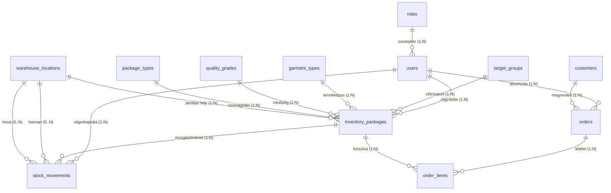

# Adatbázisterv — ReWear WMS (`due-prog-03`)

**Adatbázis-kezelő rendszer:** Beágyazott SQLite 3 (JDBC `sqlite-jdbc`, `PRAGMA foreign_keys = ON`)  
**Séma fájl:** `src/main/resources/db/schema.sql`  
**Táblák száma:** 12 normalizált relációs tábla (3NF) + 10 teljesítmény-index  

---

## 1. Logikai csoportosítás

Az adatbázis 12 táblája négy jól elkülöníthető logikai tartományra oszlik, ami átláthatóvá teszi mind a karbantartást, mind a rendszer bemutatását:

1. **Hitelesítés és jogosultság (2 tábla):** `roles`, `users`
2. **QR kódtörzsek — dinamikus szótártáblák (4 tábla):** `target_groups`, `garment_types`, `quality_grades`, `package_types` *(közvetlenül leképezik a QR termékkód szegmenseit)*
3. **Raktárkészlet és mozgásnapló (3 tábla):** `warehouse_locations`, `inventory_packages`, `stock_movements`
4. **B2B értékesítés és kiszállítás (3 tábla):** `customers`, `orders`, `order_items`

---

## 2. Egyed-kapcsolat (ER) diagram

---

## 3. Táblák részletes definíciója

### 3.1 `roles` (Jogosultsági szerepkörök)
| Oszlop | Típus | Megszorítások | Leírás |
|---|---|---|---|
| `id` | `INTEGER` | `PRIMARY KEY AUTOINCREMENT` | Egyedi azonosító |
| `code` | `TEXT` | `NOT NULL UNIQUE` | Szerepkör kód (`ADMIN`, `MANAGER`, `OPERATOR`) |
| `name` | `TEXT` | `NOT NULL` | Megnevezés |

### 3.2 `users` (Felhasználók)
| Oszlop | Típus | Megszorítások | Leírás |
|---|---|---|---|
| `id` | `INTEGER` | `PRIMARY KEY AUTOINCREMENT` | Egyedi azonosító |
| `username` | `TEXT` | `NOT NULL UNIQUE` | Bejelentkezési név |
| `password_hash` | `TEXT` | `NOT NULL` | BCrypt hash (soha nem nyílt szöveg) |
| `full_name` | `TEXT` | `NOT NULL` | Teljes név |
| `role_id` | `INTEGER` | `NOT NULL FK -> roles(id)` | Szerepkör hivatkozás |
| `active` | `INTEGER` | `NOT NULL DEFAULT 1 CHECK (0,1)` | Aktív státusz |
| `created_at` | `TEXT` | `NOT NULL` | Létrehozás időpontja (`yyyy-MM-dd HH:mm:ss`) |

### 3.3 `target_groups` (Célcsoportok — QR `WHATFOR` szegmens)
| Oszlop | Típus | Megszorítások | Leírás |
|---|---|---|---|
| `id` | `INTEGER` | `PRIMARY KEY AUTOINCREMENT` | Egyedi azonosító |
| `code` | `TEXT` | `NOT NULL UNIQUE` | Rövid kód (pl. `L`, `M`, `K`, `B`, `U`, `H`) |
| `name_en` | `TEXT` | `NOT NULL` | Angol megnevezés |
| `name_hu` | `TEXT` | `NOT NULL` | Magyar megnevezés |
| `active` | `INTEGER` | `NOT NULL DEFAULT 1 CHECK (0,1)` | Aktív státusz |

### 3.4 `garment_types` (Termék / Ruhatípusok — QR `TYPE` szegmens)
| Oszlop | Típus | Megszorítások | Leírás |
|---|---|---|---|
| `id` | `INTEGER` | `PRIMARY KEY AUTOINCREMENT` | Egyedi azonosító |
| `code` | `TEXT` | `NOT NULL UNIQUE` | Rövid kód (pl. `TSH`, `JNS`, `JKT`, `DRS`, `SHO`) |
| `name_en` | `TEXT` | `NOT NULL` | Angol megnevezés |
| `name_hu` | `TEXT` | `NOT NULL` | Magyar megnevezés |
| `active` | `INTEGER` | `NOT NULL DEFAULT 1 CHECK (0,1)` | Aktív státusz |

### 3.5 `quality_grades` (Minőségi osztályok — QR `QUALITY` szegmens)
| Oszlop | Típus | Megszorítások | Leírás |
|---|---|---|---|
| `id` | `INTEGER` | `PRIMARY KEY AUTOINCREMENT` | Egyedi azonosító |
| `code` | `TEXT` | `NOT NULL UNIQUE` | Kód (pl. `CR`, `A`, `B`, `C`) |
| `name_en` | `TEXT` | `NOT NULL` | Angol megnevezés |
| `name_hu` | `TEXT` | `NOT NULL` | Magyar megnevezés |
| `default_price_per_kg` | `REAL` | `NOT NULL DEFAULT 0 CHECK (>= 0)` | Alapértelmezett kilónkénti eladási ár (EUR/kg) |
| `active` | `INTEGER` | `NOT NULL DEFAULT 1 CHECK (0,1)` | Aktív státusz |

### 3.6 `package_types` (Csomagolástípusok — QR `PACKAGETYPE` szegmens)
| Oszlop | Típus | Megszorítások | Leírás |
|---|---|---|---|
| `id` | `INTEGER` | `PRIMARY KEY AUTOINCREMENT` | Egyedi azonosító |
| `code` | `TEXT` | `NOT NULL UNIQUE` | Kód (pl. `A` bála, `B` zsák, `C` doboz, `P` raklap) |
| `name_en` | `TEXT` | `NOT NULL` | Angol megnevezés |
| `name_hu` | `TEXT` | `NOT NULL` | Magyar megnevezés |
| `tare_weight_kg` | `REAL` | `NOT NULL DEFAULT 0 CHECK (>= 0)` | Csomagolóanyag tárasúlya (kg) |
| `max_weight_kg` | `REAL` | `NOT NULL DEFAULT 100 CHECK (> 0)` | Maximális ajánlott súly (kg) |
| `active` | `INTEGER` | `NOT NULL DEFAULT 1 CHECK (0,1)` | Aktív státusz |

### 3.7 `warehouse_locations` (Raktárhelyek)
| Oszlop | Típus | Megszorítások | Leírás |
|---|---|---|---|
| `id` | `INTEGER` | `PRIMARY KEY AUTOINCREMENT` | Egyedi azonosító |
| `code` | `TEXT` | `NOT NULL UNIQUE` | Helykód (pl. `A-01-01`) |
| `zone`, `aisle`, `shelf` | `TEXT` | `NOT NULL` | Zóna, sor, polc bontás |
| `max_capacity_kg` | `REAL` | `NOT NULL CHECK (> 0)` | Polc/hely teherbírása (kg) |
| `active` | `INTEGER` | `NOT NULL DEFAULT 1 CHECK (0,1)` | Aktív státusz |

### 3.8 `inventory_packages` (Központi csomag/bála készlet tábla)
| Oszlop | Típus | Megszorítások | Leírás |
|---|---|---|---|
| `id` | `INTEGER` | `PRIMARY KEY AUTOINCREMENT` | Egyedi azonosító |
| `qr_code` | `TEXT` | `NOT NULL UNIQUE` | Teljes strukturált QR termékkód |
| `target_group_id` | `INTEGER` | `NOT NULL FK -> target_groups(id)` | Célcsoport |
| `garment_type_id` | `INTEGER` | `NOT NULL FK -> garment_types(id)` | Terméktípus |
| `quality_grade_id` | `INTEGER` | `NOT NULL FK -> quality_grades(id)` | Minőségi osztály |
| `package_type_id` | `INTEGER` | `NOT NULL FK -> package_types(id)` | Csomagolás típusa |
| `location_id` | `INTEGER` | `NOT NULL FK -> warehouse_locations(id)` | Aktuális raktárhely |
| `weight_kg` | `REAL` | `NOT NULL CHECK (> 0)` | Nettó súly (kg) |
| `hex_suffix` | `TEXT` | `NOT NULL CHECK (length = 2)` | Véletlen 2 jegyű hexadecimális azonosító |
| `status` | `TEXT` | `CHECK ('IN_STOCK','RESERVED','SHIPPED','DISCARDED')` | Életciklus-állapot |
| `notes` | `TEXT` | `NULL` | Opcionális megjegyzés |
| `created_by` | `INTEGER` | `NOT NULL FK -> users(id)` | Rögzítő operátor |
| `created_at`, `updated_at` | `TEXT` | `NOT NULL` | Időbélyegek |

### 3.9 `customers` (B2B ügyfelek)
| Oszlop | Típus | Megszorítások | Leírás |
|---|---|---|---|
| `id` | `INTEGER` | `PRIMARY KEY AUTOINCREMENT` | Egyedi azonosító |
| `name` | `TEXT` | `NOT NULL` | Cégnév |
| `contact_name`, `email`, `phone`, `address`, `tax_number` | `TEXT` | `NULL` | Kapcsolattartási és számlázási adatok |
| `active` | `INTEGER` | `NOT NULL DEFAULT 1 CHECK (0,1)` | Aktív státusz |
| `created_at` | `TEXT` | `NOT NULL` | Létrehozás ideje |

### 3.10 `orders` (Vevői rendelések)
| Oszlop | Típus | Megszorítások | Leírás |
|---|---|---|---|
| `id` | `INTEGER` | `PRIMARY KEY AUTOINCREMENT` | Egyedi azonosító |
| `order_number` | `TEXT` | `NOT NULL UNIQUE` | Sorszám (pl. `ORD-2026-0001`) |
| `customer_id` | `INTEGER` | `NOT NULL FK -> customers(id)` | Megrendelő ügyfél |
| `status` | `TEXT` | `CHECK ('DRAFT','PACKING','SHIPPED','CANCELLED')` | Rendelés állapota |
| `total_weight_kg`, `total_price` | `REAL` | `NOT NULL DEFAULT 0 CHECK (>= 0)` | Összesített súly és végösszeg |
| `notes` | `TEXT` | `NULL` | Megjegyzés |
| `created_by` | `INTEGER` | `NOT NULL FK -> users(id)` | Létrehozó felhasználó |
| `created_at`, `shipped_at` | `TEXT` | `created_at NOT NULL` | Létrehozás és kiszállítás ideje |

### 3.11 `order_items` (Rendelési tételek — kapcsolótábla)
| Oszlop | Típus | Megszorítások | Leírás |
|---|---|---|---|
| `id` | `INTEGER` | `PRIMARY KEY AUTOINCREMENT` | Egyedi azonosító |
| `order_id` | `INTEGER` | `NOT NULL FK -> orders(id) ON DELETE CASCADE` | Rendelés |
| `package_id` | `INTEGER` | `NOT NULL FK -> inventory_packages(id)` | Kiosztott fizikai csomag |
| `price_per_kg` | `REAL` | `NOT NULL CHECK (>= 0)` | Rögzített eladási egységár (történeti ár!) |
| `line_total` | `REAL` | `NOT NULL CHECK (>= 0)` | Tétel végösszeg (`weight_kg * price_per_kg`) |
| *(összetett)* | `UNIQUE` | `UNIQUE(order_id, package_id)` | Egy csomag egy rendelésben csak egyszer szerepelhet |

### 3.12 `stock_movements` (Készletmozgás audit napló)
| Oszlop | Típus | Megszorítások | Leírás |
|---|---|---|---|
| `id` | `INTEGER` | `PRIMARY KEY AUTOINCREMENT` | Egyedi azonosító |
| `package_id` | `INTEGER` | `NOT NULL FK -> inventory_packages(id)` | Érintett csomag |
| `movement_type` | `TEXT` | `CHECK ('INTAKE','RELOCATE','SCAN_VERIFY','RESERVE','RELEASE','SHIP','DISCARD')` | Mozgás típusa |
| `from_location_id`, `to_location_id` | `INTEGER` | `FK -> warehouse_locations(id)` | Forrás és cél raktárhely |
| `user_id` | `INTEGER` | `NOT NULL FK -> users(id)` | Végrehajtó felhasználó |
| `note` | `TEXT` | `NULL` | Indoklás / hivatkozás |
| `created_at` | `TEXT` | `NOT NULL` | Mozgás pontos ideje |

---

## 4. Normalizálás igazolása (1NF → 2NF → 3NF)

- **Első normálforma (1NF):** Minden attribútum atomi értéket tartalmaz (nincsenek vesszővel elválasztott listák vagy ismétlődő oszlopcsoportok; a raktárhely is `zone`, `aisle`, `shelf` mezőkre van bontva, a rendelés csomagjai pedig a külön `order_items` táblába kerülnek). Minden táblának egyértelmű, mesterséges `id` elsődleges kulcsa van.
- **Második normálforma (2NF):** Mivel minden tábla egyetlen oszlopból álló `id` elsődleges kulccsal rendelkezik, részleges kulcsfüggőség nem léphet fel. A `order_items` táblában a `UNIQUE(order_id, package_id)` megkötés mellett az `price_per_kg` és `line_total` kifejezetten az adott rendelés-csomag párhoz tartozó történeti eladási értéket rögzíti.
- **Harmadik normálforma (3NF):** Minden nem-kulcs attribútum kizárólag az adott tábla elsődleges kulcsától függ, tranzitív függőségek nélkül:
  - A csomag tulajdonságai (`Ladies`, `T-Shirts`, `Grade A`, `Compressed Bale` és a hozzájuk tartozó alapár vagy tárasúly) **nem** ismétlődnek az `inventory_packages` táblában, hanem külön `target_groups`, `garment_types`, `quality_grades`, `package_types` törzstáblákban élnek. Ha egy kategória neve vagy alapára módosul, csak egyetlen sorban kell átírni.
  - A felhasználói szerepkör megnevezése a `roles` táblában van, az ügyfelek címe és adószáma a `customers` táblában, nem pedig minden rendelés sorában.
  - A raktárhelyek foglaltsága (`used_weight_kg`) nem tárolt redundáns mező, hanem `SUM(weight_kg)` aggregációval dinamikusan számított érték (`WarehouseLocationDao`), elkerülve a frissítési anomáliákat.

---

## 5. Indexek, tranzakciók és adatbiztonság

- **Indexek:** Külön B-tree indexek gyorsítják a QR-kód alapú szkenner-keresést (`idx_packages_qr_code`), állapot- és helyszűrést (`idx_packages_status`, `idx_packages_location`), időrendi lekérdezéseket (`idx_packages_created_at`, `idx_movements_created_at`), valamint a rendelés-tétel összekapcsolásokat.
- **Tranzakciókezelés:** Minden összetett üzleti művelet (csomagfelvétel + `INTAKE` napló, áthelyezés + `RELOCATE` napló, rendelés kiszállítása + csomagstátuszok + `SHIP` naplók) atomi tranzakcióban fut a `DatabaseManager.executeInTransaction(...)` segítségével; hiba esetén automatikus `ROLLBACK` történik.
- **Hivatkozási védelem:** A kódtörzsekben a meglévő csomagok által hivatkozott kódok fizikai törlését az alkalmazás blokkolja (inaktiválás javaslata mellett), a SQLite pedig `PRAGMA foreign_keys = ON` módban az adatbázis szintjén is garantálja a referenciális integritást.
- **Biztonsági mentés és visszaállítás:** A `BackupService` SQLite `VACUUM INTO` utasítással készít konzisztens, tömörített `.db` mentést, visszaállítás előtt pedig ellenőrzi a SQLite fejlécet és a kötelező táblák meglétét, valamint biztonsági `.db.bak` másolatot készít.
