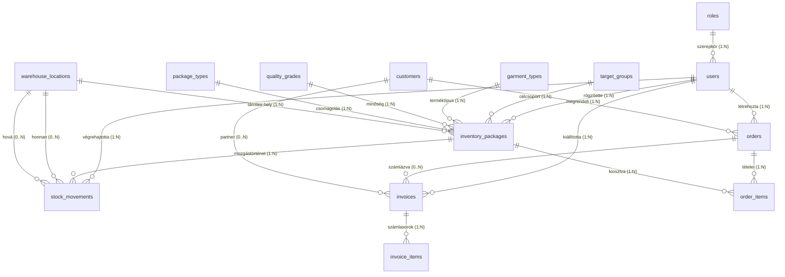

# Adatbázisterv — ReWear WMS (`due-prog-03`)

**Adatbázis-kezelő rendszer:** Beágyazott SQLite 3 (JDBC `sqlite-jdbc`, `PRAGMA foreign_keys = ON`)  
**Séma fájl:** `src/main/resources/db/schema.sql`  
**Táblák száma:** 17 normalizált relációs tábla (3NF) + 14 teljesítmény-index  

---

## 1. Logikai csoportosítás

Az adatbázis 17 táblája öt jól elkülöníthető logikai tartományra oszlik:

1. **Alkalmazás- és pénzügyi törzskonfiguráció (3 tábla):** `app_settings`, `currencies`, `tax_types`
2. **Hitelesítés és jogosultság (2 tábla):** `roles`, `users`
3. **QR kódtörzsek — dinamikus szótártáblák (4 tábla):** `target_groups`, `garment_types`, `quality_grades`, `package_types` *(közvetlenül leképezik a QR termékkód szegmenseit és az alapértelmezett EUR/HUF kilónkénti árakat)*
4. **Raktárkészlet és mozgásnapló (3 tábla):** `warehouse_locations`, `inventory_packages`, `stock_movements`
5. **B2B partnerek, rendelések és többdevizás számlázás (5 tábla):** `customers`, `orders`, `order_items`, `invoices`, `invoice_items`

---

## 2. Egyed-kapcsolat (ER) diagram

*(A konfigurációs törzstáblák — `app_settings`, `currencies`, `tax_types` — önálló referencia-/beállítástáblák, amelyekből az alkalmazás a devizakódokat, áfakulcs-szabályokat és az eladói cégprofilt tölti be.)*

---

## 3. Táblák részletes definíciója

### 3.1 `app_settings` (Hordozható alkalmazás- és cégprofil beállítások)
| Oszlop | Típus | Megszorítások | Leírás |
|---|---|---|---|
| `setting_key` | `TEXT` | `PRIMARY KEY` | Kulcs (pl. `company.name`, `company.iban.EUR`, `company.iban.HUF`, `ui.language`, `ui.theme`) |
| `setting_value` | `TEXT` | `NOT NULL` | Beállítás értéke (hordozhatóan, a `.db` fájlban tárolva) |

### 3.2 `currencies` (Konfigurálható devizák)
| Oszlop | Típus | Megszorítások | Leírás |
|---|---|---|---|
| `id` | `INTEGER` | `PRIMARY KEY AUTOINCREMENT` | Egyedi azonosító |
| `code` | `TEXT` | `NOT NULL UNIQUE` | ISO devizakód (pl. `EUR`, `HUF`, `USD`, `GBP`) |
| `name_en`, `name_hu` | `TEXT` | `NOT NULL` | Angol és magyar megnevezés |
| `symbol` | `TEXT` | `NOT NULL` | Megjelenített jelölés (`€`, `Ft`, `$`) |
| `decimal_places` | `INTEGER` | `NOT NULL DEFAULT 2 CHECK (0,2)` | Tizedesjegyek száma (`0` HUF-hoz, `2` EUR/USD-hoz) |
| `active` | `INTEGER` | `NOT NULL DEFAULT 1 CHECK (0,1)` | Aktív státusz |

### 3.3 `tax_types` (Konfigurálható ÁFA / adókulcs típusok)
| Oszlop | Típus | Megszorítások | Leírás |
|---|---|---|---|
| `id` | `INTEGER` | `PRIMARY KEY AUTOINCREMENT` | Egyedi azonosító |
| `code` | `TEXT` | `NOT NULL UNIQUE` | Rövid kód (pl. `HU_27`, `EU_0`, `EXPORT_0`, `EXEMPT`) |
| `name_en`, `name_hu` | `TEXT` | `NOT NULL` | Angol és magyar megnevezés |
| `rate_percent` | `REAL` | `NOT NULL DEFAULT 0 CHECK (>= 0)` | Adókulcs százalékban (`27`, `0`, `5`, stb.) |
| `country_scope` | `TEXT` | `CHECK ('HU','EU','NON_EU','ANY')` | Automatikus partner-ország szerinti ajánlási hatókör |
| `active` | `INTEGER` | `NOT NULL DEFAULT 1 CHECK (0,1)` | Aktív státusz |

### 3.4 `roles` (Jogosultsági szerepkörök)
| Oszlop | Típus | Megszorítások | Leírás |
|---|---|---|---|
| `id` | `INTEGER` | `PRIMARY KEY AUTOINCREMENT` | Egyedi azonosító |
| `code` | `TEXT` | `NOT NULL UNIQUE` | Szerepkör kód (`ADMIN`, `MANAGER`, `OPERATOR`) |
| `name` | `TEXT` | `NOT NULL` | Megnevezés |

### 3.5 `users` (Felhasználók)
| Oszlop | Típus | Megszorítások | Leírás |
|---|---|---|---|
| `id` | `INTEGER` | `PRIMARY KEY AUTOINCREMENT` | Egyedi azonosító |
| `username` | `TEXT` | `NOT NULL UNIQUE` | Bejelentkezési név |
| `password_hash` | `TEXT` | `NOT NULL` | BCrypt hash (soha nem nyílt szöveg) |
| `full_name` | `TEXT` | `NOT NULL` | Teljes név |
| `last_name`, `first_name` | `TEXT` | `NULL` | Családnév és keresztnév |
| `email`, `phone` | `TEXT` | `NULL` | Elérhetőségi adatok |
| `avatar_png` | `BLOB` | `NULL` | Opcionális profilkép PNG bájtok |
| `role_id` | `INTEGER` | `NOT NULL FK -> roles(id)` | Szerepkör hivatkozás |
| `active` | `INTEGER` | `NOT NULL DEFAULT 1 CHECK (0,1)` | Aktív státusz |
| `created_at` | `TEXT` | `NOT NULL` | Létrehozás időpontja (`yyyy-MM-dd HH:mm:ss`) |

### 3.6 `target_groups` (Célcsoportok — QR `WHATFOR` szegmens)
| Oszlop | Típus | Megszorítások | Leírás |
|---|---|---|---|
| `id` | `INTEGER` | `PRIMARY KEY AUTOINCREMENT` | Egyedi azonosító |
| `code` | `TEXT` | `NOT NULL UNIQUE` | Rövid kód (pl. `L`, `M`, `K`, `B`, `U`, `H`) |
| `name_en`, `name_hu` | `TEXT` | `NOT NULL` | Angol és magyar megnevezés |
| `active` | `INTEGER` | `NOT NULL DEFAULT 1 CHECK (0,1)` | Aktív státusz |

### 3.7 `garment_types` (Termék / Ruhatípusok — QR `TYPE` szegmens)
| Oszlop | Típus | Megszorítások | Leírás |
|---|---|---|---|
| `id` | `INTEGER` | `PRIMARY KEY AUTOINCREMENT` | Egyedi azonosító |
| `code` | `TEXT` | `NOT NULL UNIQUE` | Rövid kód (pl. `TSH`, `JNS`, `JKT`, `DRS`, `SHO`) |
| `name_en`, `name_hu` | `TEXT` | `NOT NULL` | Angol és magyar megnevezés |
| `price_eur_per_kg` | `REAL` | `NOT NULL DEFAULT 0 CHECK (>= 0)` | Alapértelmezett EUR/kg egységár |
| `price_huf_per_kg` | `REAL` | `NOT NULL DEFAULT 0 CHECK (>= 0)` | Alapértelmezett HUF/kg egységár |
| `active` | `INTEGER` | `NOT NULL DEFAULT 1 CHECK (0,1)` | Aktív státusz |

### 3.8 `quality_grades` (Minőségi osztályok — QR `QUALITY` szegmens)
| Oszlop | Típus | Megszorítások | Leírás |
|---|---|---|---|
| `id` | `INTEGER` | `PRIMARY KEY AUTOINCREMENT` | Egyedi azonosító |
| `code` | `TEXT` | `NOT NULL UNIQUE` | Kód (pl. `CR`, `A`, `B`, `C`) |
| `name_en`, `name_hu` | `TEXT` | `NOT NULL` | Angol és magyar megnevezés |
| `default_price_per_kg` | `REAL` | `NOT NULL DEFAULT 0 CHECK (>= 0)` | Tartalék/alapértelmezett EUR/kg eladási ár |
| `default_price_huf_per_kg` | `REAL` | `NOT NULL DEFAULT 0 CHECK (>= 0)` | Tartalék/alapértelmezett HUF/kg eladási ár |
| `active` | `INTEGER` | `NOT NULL DEFAULT 1 CHECK (0,1)` | Aktív státusz |

### 3.9 `package_types` (Csomagolástípusok — QR `PACKAGETYPE` szegmens)
| Oszlop | Típus | Megszorítások | Leírás |
|---|---|---|---|
| `id` | `INTEGER` | `PRIMARY KEY AUTOINCREMENT` | Egyedi azonosító |
| `code` | `TEXT` | `NOT NULL UNIQUE` | Kód (pl. `A` bála, `B` zsák, `C` doboz, `P` raklap) |
| `name_en`, `name_hu` | `TEXT` | `NOT NULL` | Angol és magyar megnevezés |
| `tare_weight_kg` | `REAL` | `NOT NULL DEFAULT 0 CHECK (>= 0)` | Csomagolóanyag tárasúlya (kg) |
| `max_weight_kg` | `REAL` | `NOT NULL DEFAULT 100 CHECK (> 0)` | Maximális ajánlott súly (kg) |
| `active` | `INTEGER` | `NOT NULL DEFAULT 1 CHECK (0,1)` | Aktív státusz |

### 3.10 `warehouse_locations` (Raktárhelyek)
| Oszlop | Típus | Megszorítások | Leírás |
|---|---|---|---|
| `id` | `INTEGER` | `PRIMARY KEY AUTOINCREMENT` | Egyedi azonosító |
| `code` | `TEXT` | `NOT NULL UNIQUE` | Helykód (pl. `A-01-01`) |
| `zone`, `aisle`, `shelf` | `TEXT` | `NOT NULL` | Zóna, sor, polc bontás |
| `max_capacity_kg` | `REAL` | `NOT NULL CHECK (> 0)` | Polc/hely teherbírása (kg) |
| `active` | `INTEGER` | `NOT NULL DEFAULT 1 CHECK (0,1)` | Aktív státusz |

### 3.11 `inventory_packages` (Központi csomag/bála készlet tábla)
| Oszlop | Típus | Megszorítások | Leírás |
|---|---|---|---|
| `id` | `INTEGER` | `PRIMARY KEY AUTOINCREMENT` | Egyedi azonosító |
| `qr_code` | `TEXT` | `NOT NULL UNIQUE` | Teljes strukturált QR termékkód |
| `target_group_id` | `INTEGER` | `NOT NULL FK -> target_groups(id)` | Célcsoport |
| `garment_type_id` | `INTEGER` | `NOT NULL FK -> garment_types(id)` | Terméktípus |
| `quality_grade_id` | `INTEGER` | `NOT NULL FK -> quality_grades(id)` | Minőségi osztály |
| `package_type_id` | `INTEGER` | `NOT NULL FK -> package_types(id)` | Csomagolás típusa |
| `location_id` | `INTEGER` | `NOT NULL FK -> warehouse_locations(id)` | Aktuális raktárhely |
| `weight_kg` | `REAL` | `NOT NULL CHECK (> 0)` | Nettó súly (kg) |
| `hex_suffix` | `TEXT` | `NOT NULL CHECK (length = 2)` | Véletlen 2 jegyű hexadecimális azonosító |
| `status` | `TEXT` | `CHECK ('IN_STOCK','RESERVED','SHIPPED','DISCARDED')` | Életciklus-állapot |
| `notes` | `TEXT` | `NULL` | Opcionális megjegyzés |
| `created_by` | `INTEGER` | `NOT NULL FK -> users(id)` | Rögzítő operátor |
| `created_at`, `updated_at` | `TEXT` | `NOT NULL` | Időbélyegek |

### 3.12 `customers` (B2B üzleti partnerek — Vevők és Beszállítók)
| Oszlop | Típus | Megszorítások | Leírás |
|---|---|---|---|
| `id` | `INTEGER` | `PRIMARY KEY AUTOINCREMENT` | Egyedi azonosító |
| `name` | `TEXT` | `NOT NULL` | Cégnév |
| `partner_type` | `TEXT` | `CHECK ('CUSTOMER','SUPPLIER','BOTH')` | Üzleti szerep (vevő / beszállító / mindkettő) |
| `contact_name`, `email`, `phone`, `address`, `tax_number` | `TEXT` | `NULL` | Kapcsolattartási és számlázási adatok |
| `country_code` | `TEXT` | `NOT NULL DEFAULT 'HU'` | ISO-2 országkód (pl. `HU`, `AT`, `DE`, `RO`) — ÁFA-ajánláshoz |
| `preferred_currency` | `TEXT` | `NOT NULL DEFAULT 'EUR'` | Preferált számlázási deviza (`EUR`, `HUF`, `USD`, ...) |
| `active` | `INTEGER` | `NOT NULL DEFAULT 1 CHECK (0,1)` | Aktív státusz |
| `created_at` | `TEXT` | `NOT NULL` | Létrehozás ideje |

### 3.13 `orders` (Vevői rendelések)
| Oszlop | Típus | Megszorítások | Leírás |
|---|---|---|---|
| `id` | `INTEGER` | `PRIMARY KEY AUTOINCREMENT` | Egyedi azonosító |
| `order_number` | `TEXT` | `NOT NULL UNIQUE` | Sorszám (pl. `ORD-2026-0001`) |
| `customer_id` | `INTEGER` | `NOT NULL FK -> customers(id)` | Megrendelő partner |
| `status` | `TEXT` | `CHECK ('DRAFT','PACKING','SHIPPED','CANCELLED')` | Rendelés állapota |
| `currency` | `TEXT` | `NOT NULL DEFAULT 'EUR'` | Rendelés devizája |
| `total_weight_kg`, `total_price` | `REAL` | `NOT NULL DEFAULT 0 CHECK (>= 0)` | Összesített súly és végösszeg |
| `notes` | `TEXT` | `NULL` | Megjegyzés |
| `created_by` | `INTEGER` | `NOT NULL FK -> users(id)` | Létrehozó felhasználó |
| `created_at`, `shipped_at` | `TEXT` | `created_at NOT NULL` | Létrehozás és kiszállítás ideje |

### 3.14 `order_items` (Rendelési tételek — kapcsolótábla)
| Oszlop | Típus | Megszorítások | Leírás |
|---|---|---|---|
| `id` | `INTEGER` | `PRIMARY KEY AUTOINCREMENT` | Egyedi azonosító |
| `order_id` | `INTEGER` | `NOT NULL FK -> orders(id) ON DELETE CASCADE` | Rendelés |
| `package_id` | `INTEGER` | `NOT NULL FK -> inventory_packages(id)` | Kiosztott fizikai csomag |
| `price_per_kg` | `REAL` | `NOT NULL CHECK (>= 0)` | Rögzített / kialkudott eladási egységár (történeti ár) |
| `line_total` | `REAL` | `NOT NULL CHECK (>= 0)` | Tétel végösszeg (`weight_kg * price_per_kg`) |
| *(összetett)* | `UNIQUE` | `UNIQUE(order_id, package_id)` | Egy csomag egy rendelésben csak egyszer szerepelhet |

### 3.15 `stock_movements` (Készletmozgás audit napló)
| Oszlop | Típus | Megszorítások | Leírás |
|---|---|---|---|
| `id` | `INTEGER` | `PRIMARY KEY AUTOINCREMENT` | Egyedi azonosító |
| `package_id` | `INTEGER` | `NOT NULL FK -> inventory_packages(id)` | Érintett csomag |
| `movement_type` | `TEXT` | `CHECK ('INTAKE','RELOCATE','SCAN_VERIFY','RESERVE','RELEASE','SHIP','DISCARD')` | Mozgás típusa |
| `from_location_id`, `to_location_id` | `INTEGER` | `FK -> warehouse_locations(id)` | Forrás és cél raktárhely |
| `user_id` | `INTEGER` | `NOT NULL FK -> users(id)` | Végrehajtó felhasználó |
| `note` | `TEXT` | `NULL` | Indoklás / hivatkozás |
| `created_at` | `TEXT` | `NOT NULL` | Mozgás pontos ideje |

### 3.16 `invoices` (Kimenő és bejövő többdevizás számlák & jóváíró számlák)
| Oszlop | Típus | Megszorítások | Leírás |
|---|---|---|---|
| `id` | `INTEGER` | `PRIMARY KEY AUTOINCREMENT` | Egyedi azonosító |
| `invoice_number` | `TEXT` | `NOT NULL UNIQUE` | Sorszám (`INV-YYYY-NNNN`, `EXP-YYYY-NNNN`, `CN-YYYY-NNNN`) |
| `direction` | `TEXT` | `CHECK ('OUTGOING','INCOMING')` | Számla iránya (bevétel / kiadás) |
| `category` | `TEXT` | `NOT NULL` | Kategória (`ORDER_SALE`, `CREDIT_NOTE`, `RAW_MATERIAL`, `RENT`, `UTILITIES`, `SHIPPING`, `SALARY`, `OTHER`) |
| `order_id` | `INTEGER` | `FK -> orders(id) ON DELETE SET NULL` | Kapcsolódó rendelés (opcionális) |
| `customer_id` | `INTEGER` | `FK -> customers(id) ON DELETE SET NULL` | Kapcsolódó partner (opcionális) |
| `partner_name`, `partner_tax_number`, `partner_address`, `partner_email` | `TEXT` | `partner_name NOT NULL` | Kiállításkori pillanatfelvétel a partner adatairól (történeti megőrzés) |
| `status` | `TEXT` | `CHECK ('DRAFT','ISSUED','PAID','OVERDUE','CANCELLED')` | Pénzügyi állapot (lejárt `ISSUED` automatikusan `OVERDUE`) |
| `issue_date`, `due_date`, `paid_date` | `TEXT` | `issue_date, due_date NOT NULL` | Kiállítási, fizetési határidő és kiegyenlítési dátum |
| `net_amount`, `vat_rate`, `vat_amount`, `gross_amount` | `REAL` | `NOT NULL CHECK (>= 0)` | Nettó, ÁFA %, ÁFA összeg és bruttó végösszeg |
| `tax_type_code` | `TEXT` | `NULL` | Alkalmazott adótípus kód (pl. `HU_27`, `EU_0`) |
| `currency` | `TEXT` | `NOT NULL DEFAULT 'EUR'` | Saját devizanem (nem kerül átváltásra más főkönyvbe) |
| `exchange_rate` | `REAL` | `NOT NULL DEFAULT 400.0 CHECK (> 0)` | Tájékoztató árfolyam-pillanatfelvétel |
| `attachment_path` | `TEXT` | `NULL` | Relatív hivatkozás a `./data/receipts/` mappában tárolt bizonylatra (PDF/PNG/JPG) |
| `created_by` | `INTEGER` | `NOT NULL FK -> users(id)` | Kiállító felhasználó |
| `created_at` | `TEXT` | `NOT NULL` | Rögzítés időpontja |

### 3.17 `invoice_items` (Számlasorok — többsoros számlázáshoz)
| Oszlop | Típus | Megszorítások | Leírás |
|---|---|---|---|
| `id` | `INTEGER` | `PRIMARY KEY AUTOINCREMENT` | Egyedi azonosító |
| `invoice_id` | `INTEGER` | `NOT NULL FK -> invoices(id) ON DELETE CASCADE` | Szülő számla |
| `description` | `TEXT` | `NOT NULL` | Tétel megnevezése |
| `quantity` | `REAL` | `NOT NULL CHECK (> 0)` | Mennyiség |
| `unit` | `TEXT` | `NOT NULL DEFAULT 'kg'` | Mértékegység (`kg`, `db`, `bála`, `hó`, stb.) |
| `unit_price` | `REAL` | `NOT NULL CHECK (>= 0)` | Nettó egységár a számla devizájában |
| `line_net` | `REAL` | `NOT NULL CHECK (>= 0)` | Sor nettó összege (`quantity * unit_price`) |

---

## 4. Normalizálás igazolása (1NF → 2NF → 3NF)

- **Első normálforma (1NF):** Minden attribútum atomi értéket tartalmaz (nincsenek vesszővel elválasztott listák vagy ismétlődő oszlopcsoportok; a raktárhely `zone`, `aisle`, `shelf` mezőkre bontott, a rendelési tételek az `order_items`, a számlasorok pedig az `invoice_items` táblába kerülnek). Minden táblának egyértelmű elsődleges kulcsa van.
- **Második normálforma (2NF):** Minden entitástábla egyetlen oszlopból álló `id` (vagy `setting_key`) elsődleges kulccsal rendelkezik, így részleges kulcsfüggőség nem léphet fel. Az `order_items` (`UNIQUE(order_id, package_id)`) és `invoice_items` táblák nem-kulcs mezői kizárólag az adott tételsort írják le.
- **Harmadik normálforma (3NF):** Minden nem-kulcs attribútum kizárólag az adott tábla elsődleges kulcsától függ:
  - A csomag tulajdonságai (`target_groups`, `garment_types`, `quality_grades`, `package_types`) külön szótártáblákban élnek, nem ismétlődnek az `inventory_packages` soraiban.
  - A szerepkörök (`roles`), devizák (`currencies`) és adókulcsok (`tax_types`) külön törzstáblákba vannak kiszervezve.
  - A raktárhelyek foglaltsága (`used_weight_kg`) és a készletértékelés (`StockValuation`) nem tárolt redundáns mező, hanem SQL aggregációval (`SUM(weight_kg)`, `SUM(weight_kg * COALESCE(...))`) dinamikusan számított érték.
  - A `invoices` táblában tárolt partnernév/adószám/cím **szándékos számviteli pillanatfelvétel** (a kiállított számla nem változhat meg visszamenőleg, ha a partner később elköltözik), miközben az élő partnerkapcsolat a `customer_id` külső kulcson keresztül megmarad.

---

## 5. Indexek, tranzakciók és adatbiztonság

- **14 B-tree index:** Gyorsítja a QR-kód alapú szkenner-keresést (`idx_packages_qr_code`), állapot- és helyszűrést (`idx_packages_status`, `idx_packages_location`), időrendi listázást (`idx_packages_created_at`, `idx_movements_created_at`), valamint az összes partner-, rendelés- és számla-összekapcsolást (`idx_orders_customer`, `idx_orders_status`, `idx_order_items_order`, `idx_order_items_package`, `idx_invoices_direction`, `idx_invoices_order`, `idx_invoices_customer`, `idx_invoice_items_invoice`, `idx_movements_package`).
- **Tranzakciókezelés:** Minden összetett üzleti művelet (csomagfelvétel + `INTAKE` napló, kötegelt áthelyezés + `RELOCATE` naplók, rendelés kiszállítása + `SHIP` naplók, számla + tételek + jóváíró számla létrehozása) atomi tranzakcióban fut a `DatabaseManager.executeInTransaction(...)` segítségével, egyetlen megosztott JDBC kapcsolaton (beágyazott írási zárolás/SQLITE_BUSY elkerülésével).
- **Hivatkozási védelem és biztonsági mentés:** A `PRAGMA foreign_keys = ON` adatbázis-szinten, a `DictionaryDao` használat-ellenőrzése pedig alkalmazás-szinten akadályozza meg a hivatkozott törzsadatok törlését. A SQLite alapértelmezett rollback-journal módját használja (WAL helyett), így a `BackupService` (`VACUUM INTO`) egyetlen önálló, azonnal hordozható `.db` fájlt állít elő, visszaállításkor pedig fejléc-, séma-ellenőrzést és `.db.bak` biztonsági mentést végez.
