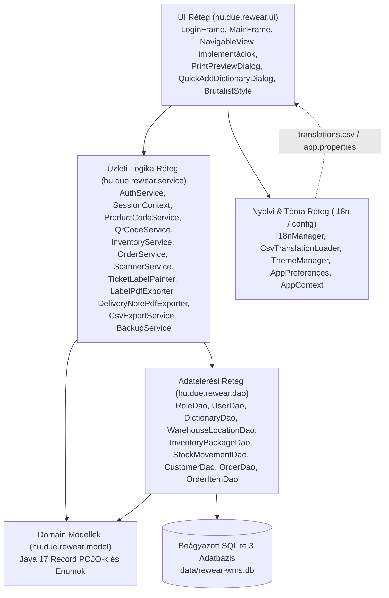
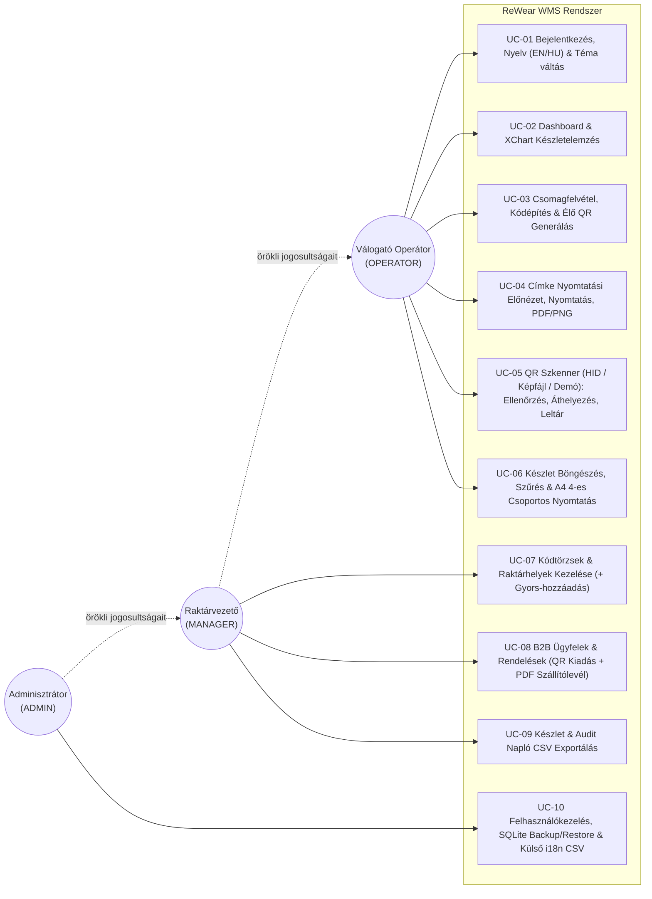
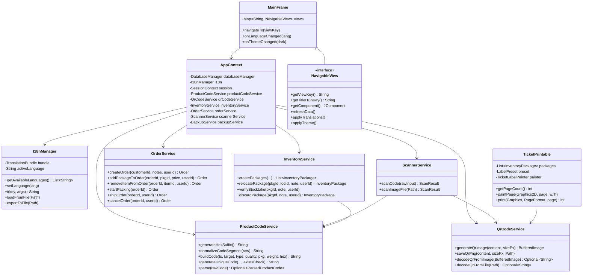
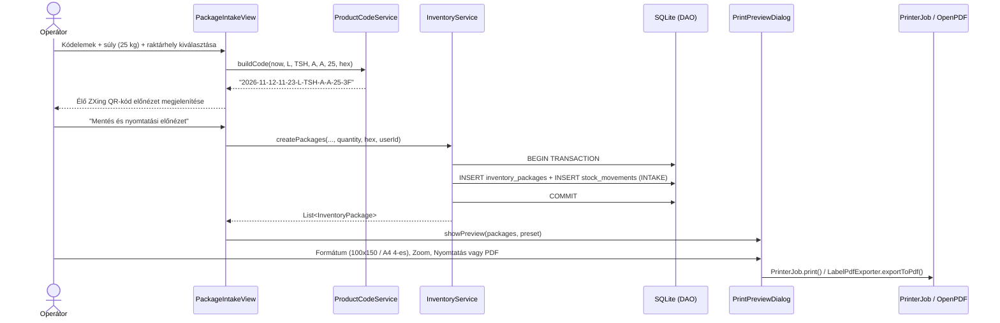
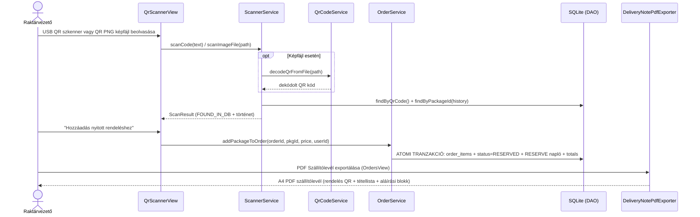

# Programterv — ReWear WMS (`due-prog-03`)

Ez a dokumentum a **ReWear WMS** szoftverarchitektúráját, használati eseteit (Use-Case), UML osztálymodelljét és főbb futásidejű folyamatait (szekvenciadiagramok) mutatja be.

---

## 1. Rétegzett architektúra (Layered MVC)

Az alkalmazás szigorúan elkülönített rétegekre épül a `hu.due.rewear` gyökércsomag alatt:

### Alkalmazott tervezési minták
- **DAO / Repository minta:** Minden SQL lekérdezés paraméterezett `PreparedStatement`-ekkel a `dao` csomagban izolált (SQL-injekció elleni védelem, cserélhető perzisztencia).
- **Dependency Container (`AppContext`):** Központi konténer példányosítja és köti össze az adatbázist, DAO-kat, szolgáltatásokat és i18n kezelőt.
- **Observer / Listener minta:** `LanguageChangeListener` és `ThemeManager.ThemeChangeListener` biztosítja az azonnali, újraindítás nélküli nyelv- és téma-váltást (EN/HU/egyedi CSV nyelv, Brutalist Világos/Sötét).
- **Strategy / Preset minta:** A `LabelPreset` enum (`THERMAL_100X150`, `THERMAL_80X100`, `A6_CARD`, `A4_4UP`) egységesen vezérli a `TicketPrintable` (Swing előnézet + `PrinterJob`) és a `LabelPdfExporter` (OpenPDF) elrendezését.

---

## 2. Use-Case diagram és használati esetek

---

## 3. UML Osztálydiagram (Kiemelt osztályok)

---

## 4. Fő folyamatok szekvenciadiagramjai

### 4.1 Csomagfelvétel, élő QR-kód generálás és címkenyomtatás

### 4.2 QR szkennelés és rendeléshez rendelés + PDF szállítólevél

---

## 5. Tesztelési terv és eredmények (JUnit 5)

A rendszer üzleti logikáját, fájlkezelését, adatbázis-integritását és PDF/QR generálását **10 tesztosztály, összesen 24 automatizált JUnit 5 teszt** ellenőrzi:

| Tesztosztály | Ellenőrzött funkcionalitás |
|---|---|
| `I18nManagerTest` (4 teszt) | EN/HU fordítások, paraméteres formázás, 3. nyelv (`de`) dinamikus felismerése CSV-ből, veszteségmentes CSV export/újratöltés, fallback kezelés |
| `ProductCodeServiceTest` (4 teszt) | `2026-11-12-11-23-L-TSH-A-A-25-3F` konvenció, tizedes súlyok, egyedi kódszegmensek normalizálása, 40 ütközésmentes véletlen hex végződés, hibás kódok elutasítása |
| `DatabaseLayerIntegrationTest` (4 teszt) | 12 táblás séma + idempotens seed, BCrypt ellenőrzés, egyedi kódtörzsek létrehozása, `UNIQUE` és `FOREIGN KEY` megszorítások kikényszerítése, telítettség és statisztikák |
| `AuthServiceTest` (3 teszt) | `ADMIN` / `MANAGER` / `OPERATOR` RBAC mátrix, hibás jelszó és inaktív fiók elutasítása, jelszócsere, `AppPreferences` perzisztencia |
| `QrCodeServiceTest` (1 teszt) | ZXing QR generálás → PNG fájl mentés → dekódolás pontos round-trip ellenőrzése |
| `InventoryServiceAndLabelPdfTest` (2 teszt) | Atomi kötegelt csomagfelvétel + áthelyezés + leltári ellenőrzés + magyar nyelvű Thermal 100×150 és A4 4-es PDF címke generálás |
| `ScannerAndOrderServiceTest` (2 teszt) | Szöveges & képfájlos QR szkennelés összes állapota + teljes rendelési életciklus (`DRAFT` → `PACKING` → `SHIPPED` és `CANCELLED` készlet-felszabadítás) |
| `CsvExportAndDictionaryGuardTest` (2 teszt) | UTF-8 BOM magyar készlet és audit napló CSV export, hivatkozott kódtörzs törlésvédelme |
| `DeliveryNotePdfExporterTest` (1 teszt) | Angol és magyar A4 PDF szállítólevél generálása rendelés QR-kóddal |
| `BackupServiceTest` (1 teszt) | SQLite `VACUUM INTO` biztonsági mentés, visszaállítás, előzetes `.db.bak` mentés, érvénytelen fájl elutasítása |
