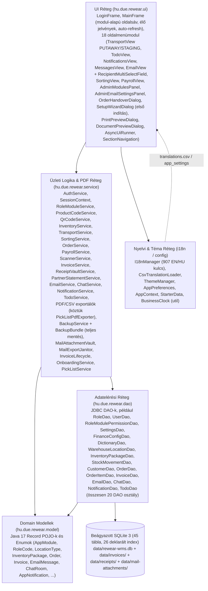
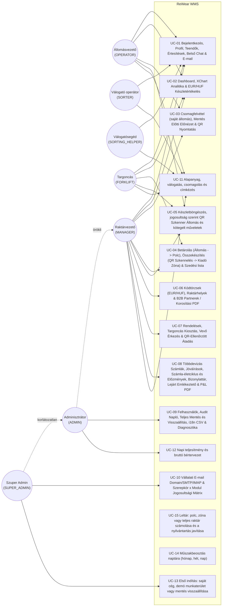
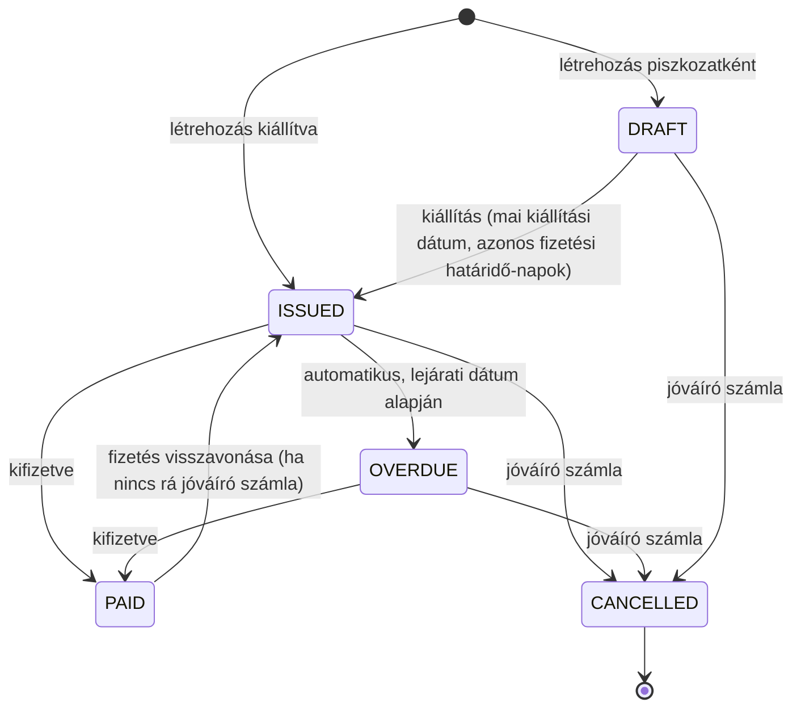
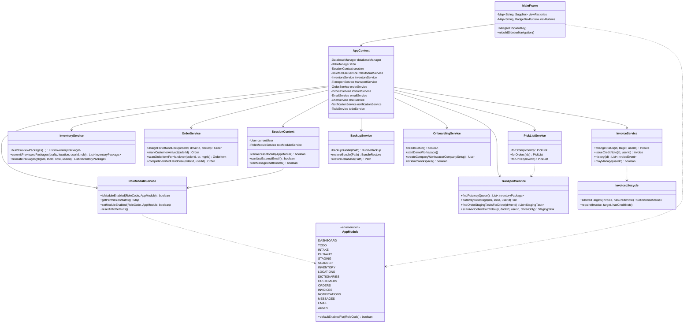
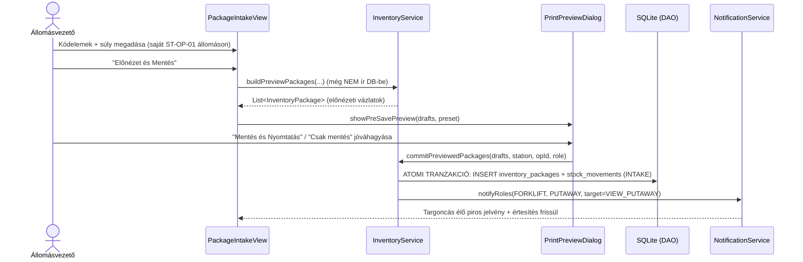
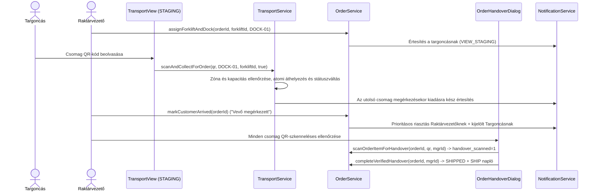
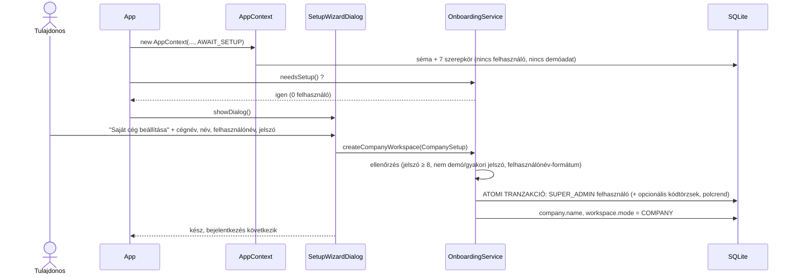
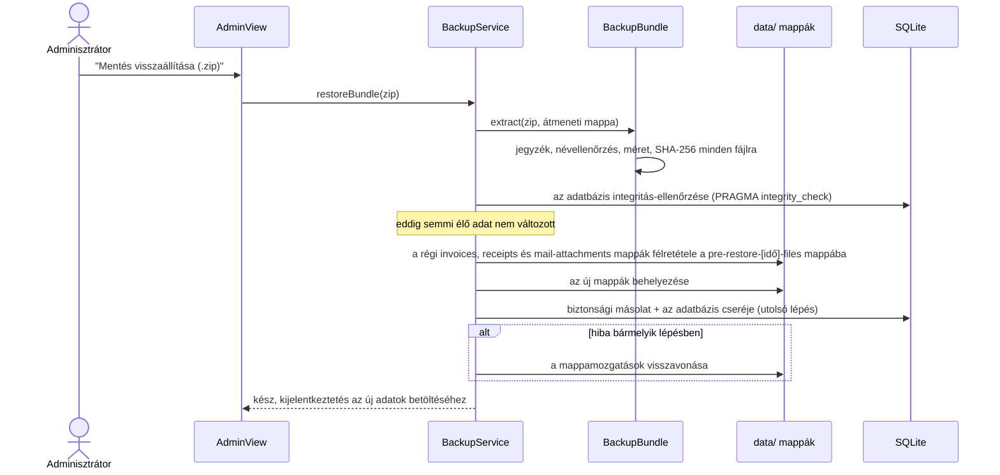

# Programterv — ReWear WMS (`due-prog-03`)

Ez a dokumentum a **ReWear WMS** szoftverarchitektúráját, használati eseteit (Use-Case), UML osztálymodelljét, főbb futásidejű folyamatait (szekvenciadiagramok) és automatizált tesztelési eredményeit mutatja be.

---

## 1. Rétegzett architektúra (Layered MVC)

Az alkalmazás szigorúan elkülönített rétegekre épül a `hu.due.rewear` gyökércsomag alatt (**179 fő Java forrásfájl**, **43 JUnit 5 tesztosztály**, **157 teszt**):

### Alkalmazott tervezési minták
- **DAO / Repository minta:** Minden SQL lekérdezés paraméterezett `PreparedStatement`-ekkel a `dao` csomagban izolált, és írási tranzakciókban megosztott `Connection` példányt használ (`runInTransaction`).
- **Dependency Container (`AppContext`):** Központi konténer példányosítja és köti össze az adatbázist, a DAO-kat, a szolgáltatásokat és az i18n kezelőt.
- **Observer / Listener minta:** `LanguageChangeListener`, `ThemeManager.ThemeChangeListener`, `NotificationService` és `RoleModuleService` változás-figyelők biztosítják a nyelv, téma, élő jelvények és modul-jogosultságok újraindítás nélküli, azonnali frissítését.
- **Strategy / Document Source minta:** A `LabelPreset` enum (`THERMAL_100X150`, `THERMAL_80X100`, `A6_CARD`, `A4_4UP`) vezérli a címkenyomtatást (beleértve a kötelező mentés előtti előnézetet is), a `DocumentPageSource` interfész pedig egységesíti az A4 PDF számlák, jóváíró számlák, szállítólevelek, partner korosítási egyenlegközlők és P&L riportok kezelését.
- **Lazy View Factory & Off-EDT Worker minta:** A `MainFrame` `Supplier<NavigableView>` gyárakkal lustán hozza létre a nézeteket (kirajzolás előtti azonnali `refreshData()` hívással, üres képkocka nélkül), az `AsyncUiRunner` pedig `SwingWorker` segítségével a háttérszálra viszi a 250–300 DPI PDF generálást, CSV exportot, készletszűrést és oldalsáv-jelvény lekérdezéseket.
- **Egyetlen üzleti óra (`BusinessClock`):** Minden üzleti dátum és időbélyeg a raktár `Europe/Budapest` időzónájából készül, nem a gép időzónájából. A `BusinessClockUsageTest` építési őrteszt, amely megbuktatja a buildet, ha valaki közvetlen `LocalDate.now()` hívást vagy SQLite UTC-órát (`datetime('now')`) használ. A `BusinessClockTest` a gépet Los Angelesbe állítja, és ellenőrzi, hogy a válogatás, a bérszámfejtés, a jogosultsági mátrix időbélyege és a csatolmánytár dátummappája budapesti marad.
- **Állapotgép (`InvoiceLifecycle`):** A számla kézi állapotváltásai egyetlen helyen vannak megadva. Szabályok: `DRAFT → ISSUED`, `ISSUED`/`OVERDUE → PAID`, `PAID → ISSUED`; kiállítás után nincs visszatérés `DRAFT`-ba, a `CANCELLED` csak jóváíró számlával keletkezik és végleges, a jóváíró számla állapota nem módosítható, a jóváírt és kifizetett számla fizetése nem vonható vissza. Minden váltás naplóbejegyzést ír (`invoice_events`).
- **Szolgáltatás-szintű jogosultság:** Az `InvoiceService.Access` szabályt a `AppContext` a szerepkör × modul mátrix `INVOICES` moduljához köti, így az állapotváltás és a jóváírás a szolgáltatásban is ellenőrzött (aktív felhasználó, jogosult szerepkör), nem csak a menü rejti el.
- **Átmeneti mappa + atomi csere (teljes mentés):** A `BackupService` a visszaállítást egy átmeneti mappában ellenőrzi (jegyzék, ellenőrző összegek, adatbázis-integritás), a mappákat félreteszi és kicseréli, az adatbázist utoljára cseréli, hiba esetén visszavonja a mozgatásokat.
- **Csatolmánytár (`MailAttachmentVault`):** A levélcsatolmány másolata a `data/mail-attachments/ÉÉÉÉ/HH/` mappába kerül relatív útvonallal, fájltípus- és fájlfejléc-ellenőrzéssel, hivatkozásszámlálós törléssel; a megnyitás csak a tárból vagy engedélyezett régi útvonalról lehetséges.
- **Explicit első indítás (`OnboardingService`):** Üres adatbázis nem tölt be demóadatot magától. Az első indításkor a tulajdonos három út közül választ: saját cég (egyetlen szuper-adminisztrátori fiók, nyilvános jelszavak tiltása), demó munkaterület vagy mentés visszaállítása. A demó belépő gombok csak demó munkaterületen jelennek meg.
- **Nyersanyag-ellátás:** A napi begyűjtések (`sorting_raw_lots`) anyaggal és gyűjtési területtel érkeznek, a
  targoncás betárolja őket egy polcra, és csak ettől kezdve igényelhetők. A válogató nem súlyt ad meg, hanem
  tételt választ; a ténylegesen átadott mennyiséget a targoncás rögzíti átadáskor.
- **Szedési lista (`PickListService`):** A nyitott összekészítési feladatokból bejárási sorrendű lista (zóna, sor, polc; a számok értékük szerint rendezve, így a 2. sor a 10. előtt van). Egy csomag akkor gyűjtött, ha a kiadó zónában van, így a haladás nem tárol külön számlálót.
- **Oldalsáv:** Kis ablakmagasságnál a menüpontok külön görgethetők. Az avatar és a fiókvezérlők az oldalsáv alján maradnak.
- **Másodlagos oldalsáv:** Az adminisztráció, a kódtörzsek és a számlázás szakaszai a levelező mappamenüjéhez hasonlóan görgethetők és ikonokra csukhatók. A `SectionNavigation` a kiválasztott panelt `CardLayout` segítségével jeleníti meg.
- **E-mail beállítások:** Az űrlap a rendelkezésre álló szélességhez igazodik. Szűkebb nézetben a domain, az üzemmód és a szinkronizálás vezérlői több sorba rendeződnek. Az SMTP- és IMAP-mezők rugalmas szélességűek, a lap szükség esetén függőlegesen görgethető.
- **Fiókszerkesztés:** A Felhasználók listában dupla kattintás vagy Enter nyitja meg a szerkesztőt. Az opcionális jelszó-visszaállításhoz két egyező mező szükséges. Az egyedi e-mail címet csak Szuperadmin módosíthatja a szerkesztőben. A saját profilban a cím csak olvasható. Az Admin közös menüsorrendje Felhasználók, Számlabeállítások, NAV-integráció, Banki integráció, Adatbázis, Fordítások, Log és Rendszer. Szuperadminnál a Szerepkörök a Számlabeállítások fölött, az E-mail beállítások alatta jelenik meg. A módosult vagy elérhetetlen külső fordítási CSV értesítést és jelvényt ad az Admin menüben.

- **Válogatás:** A válogató alapanyagot igényel és rögzíti a válogatott tételeket. A segéd csomagol, az állomásvezető címkéz és készletre vesz. A napi cél a ténylegesen feldolgozott alapanyagból számítódik. A [megvalósítási terv](Sorting-to-Sale-Implementation.md) a folyamatrögzítést és a webshopimportot is leírja.
- **Bérszámfejtés:** Az Adminisztrátor és a Szuperadmin választhat munkanapot, rögzíthet hatályos havi és részlegenkénti bruttó díjakat, illetve megoszthat egy napot több részleg között. A `PayrollService` a válogató feldolgozott súlyát és a segéd tényleges csomagolását mutatja. A jóváhagyott műszakbónuszt a bruttó tervezethez adja. A számítás szabályait a [bérszámfejtési terv](Payroll-Implementation-Plan.md) rögzíti.
- **Számlák és intelligens mappák:** A számlaoldal az összes számlával indul. A jobb oldali szűrősávban kereshetők a partnerek és szállítók. Az aktív partner-, irány-, deviza-, állapot- és kategóriaszűrőkből intelligens mappa hozható létre. Kizárólag bejövő vagy kimenő irány esetén a megfelelő ikon az alapértelmezett. A fogaskerék csak kibontott menüben jelenik meg. A fejléc hárompontos menüjében elérhető pénzügyi PDF-riport a kijelölt teljes devizafőkönyveket mutatja. A bezárt szűrősáv aktív feltételeit piros pont jelzi. A CSV export a látható listát követi. Keskeny nézetben a lista a legfontosabb oszlopokat jeleníti meg. Dupla kattintás vagy Enter nyitja meg a teljes számlabontást és a műveleteket.
- **Számlabeállítások:** Az Admin oldalon külön szerkeszthető az utca, a város és az irányítószám, a számlázási e-mail-címet a szuperadmin módosíthatja. Minden konfigurált devizához külön IBAN mező tartozik. A számla és a fizetési emlékeztető a hozzá tartozó deviza IBAN-ját jeleníti meg, ha van ilyen. Az áfa- és devizasor szerkesztője dupla kattintással vagy Enterrel nyílik meg. A törlés megerősítést kér.
- **Dokumentumküldés és rendezés:** A PDF-előnézet az alkalmazás saját levélszerkesztőjét nyitja meg a csatolt dokumentummal és a fájlmappa megnyitására szolgáló gombbal. A táblázatok oszlopfejlécein a nyilak a rendezési irányt jelzik.
- **Számlafelvétel:** A kimenő számla rendeléskeresőből indul. A rendelési tételek csak olvashatók, és mentéskor újra ellenőrzésre kerülnek. Kézi bevétel vagy kiadás esetén a partner és a számla egy tranzakcióban mentődik. Tételsorok vagy nettó összeg adható meg, számlánként egy konfigurált áfatípussal és opcionális PDF/PNG/JPEG bizonylattal.
- **Számlaarchívum és bizonylattár:** A mentés PDF-t készít a `data/invoices/ÉÉÉÉ/HH/` mappába. A feltöltött bizonylat a `data/receipts/ÉÉÉÉ/HH/` mappába kerül. A fájlnév a számla kiállítási dátumát, a fájlnévhez igazított partnernevet és a bruttó összeget tartalmazza. Névütközéskor utótag különbözteti meg a fájlokat. A logós indítóablak jelzi a tárhely előkészítését, az adatbázis megnyitását és a szolgáltatások betöltését. A munkaterületek fejlécét egypixeles vonal választja el.
- **NAV- és banki integráció:** A NAV Online Számla 3.0 beállítási űrlapja és számla-előnézete helyi demó. A kimenő számláknál kibocsátói adatszolgáltatást, a bejövőknél számlalekérdezést mutat. A banki oldal kézi számlákat és jóváírásokat vagy terheléseket kezel. A könyvelt egyenleg a nyitó egyenleg és az előjeles tranzakciók összege, `BigDecimal` pontossággal és devizánként elkülönítve.
- **Mentett szűrések:** A `SmartFolderDao` felhasználónként tárolja a névvel és ikonnal mentett számla- és e-mail-szűréseket. A szabályok az eredeti rekordokat jelenítik meg. A mappasor fogaskereke megnyitja az átméretezhető szerkesztőt és a megerősítést kérő törlést. Minden választható szűrőcsoport első eleme az Összes. A szerkesztő közvetlenül megnyílik, az SVG-ikonkészlet kereshető és két soronként bővíthető.

---

## 2. Use-Case diagram és használati esetek

### 2.1 A számla állapotgépe

A nyilak közül kézzel csak a kiállítás, a kifizetés és a fizetés visszavonása végezhető. A `CANCELLED` és az `OVERDUE` állapotot nem lehet legördülő menüből beállítani. Kifizetett számla jóváírásakor az eredeti `PAID` marad, a jóváíró számla pedig ellentétes irányú, szintén kifizetett tételként kerül a főkönyvbe, így az adott deviza főkönyve nullára zárul.

---

## 3. UML Osztálydiagram (Kiemelt osztályok)

---

## 4. Fő folyamatok szekvenciadiagramjai

### 4.1 Operátori csomagfelvétel kötelező mentés előtti előnézettel és targoncás értesítéssel

### 4.2 Targoncás QR-szkenneléses komissiózás, vevő érkezés és ellenőrzött kiadás

A kijelölt átvételnél az állapotválasztó is ellenőrzi az összes QR-beolvasást és a kiadási zónát. Ismételt beolvasás esetén egyetlen ellenőrzési mozgás marad a naplóban. Újranyitáskor törlődnek a korábbi átadás jelölései.

A rendelési dokumentumok előnézete a szállítólevelet és a már meglévő számlát mutatja. Új számla a számlázási űrlapon állítható ki.

### 4.3 Első indítás: saját cég létrehozása

Ha a tulajdonos a demó munkaterületet választja, az `OnboardingService.startDemoWorkspace()` tölti be a mintaraktárat és a demó fiókokat, és `workspace.mode = DEMO` kerül mentésre. Ettől kezdve a bejelentkezési ablak mutatja a demó belépő gombokat. Már használatban lévő adatbázison a program indításkor nem tölt be mintaadatot.

### 4.4 Teljes mentés visszaállítása

---

## 5. Tesztelési terv és eredmények (JUnit 5)

A rendszer üzleti logikáját, 42 táblás adatbázis-integritását, többdevizás pénzügyi számításait, targoncás és átadási folyamatait, levelezését és csatolmánytárát, belső chatjét, értesítéseit, modul-jogosultsági mátrixát, számla-életciklusát, teljes mentését és első indítását, valamint háttérszálú UI-futtatását **43 tesztosztály, összesen 157 automatizált JUnit 5 teszt** ellenőrzi. A `./mvnw clean verify` ezeket futtatja, kijelző nélküli (headless) környezetben is lefut, ilyenkor az egyetlen kijelzőt igénylő teszt kimarad. Külön CI szolgáltatást a projekt nem használ.

| Tesztosztály | Tesztek | Ellenőrzött funkcionalitás |
|---|:---:|---|
| `SortingToSaleWorkflowTest` | 2 | Alapanyag, válogatás, csomagolás és készletre vétel. Webshopimport, készletfoglalás, ellenőrzött kiadás és számlázás. |
| `PayrollWorkflowTest` | 1 | Rugalmas csapatlétszám, tényleges segédteljesítmény, megosztott műszak és dátumfüggő díjtételek. |
| `OfflineIntegrationTest` | 2 | A NAV demó adatainak mentése hitelesítő adatok nélkül. Több bankszámla, új deviza és pontos egyenleg újranyitás után. |
| `I18nManagerTest` | 5 | EN/HU fordítások, paraméteres formázás, 3. nyelv (`de`) dinamikus CSV betöltése, export/újratöltés, teljes **847 kulcsos** `translations.csv` szerkezeti integritás-ellenőrzés |
| `ProductCodeServiceTest` | 4 | `YYYY-MM-DD-HH-MM-...` konvenció, tizedes súlyok, szegmens-normalizálás, 40 ütközésmentes hex végződés, hibás kódok elutasítása |
| `DatabaseLayerIntegrationTest` | 4 | 42 táblás séma + idempotens demo seed, BCrypt ellenőrzés, egyedi kódtörzsek, `UNIQUE` és `FOREIGN KEY` megszorítások, telítettség és statisztikák |
| `SmartFolderTest` | 2 | Mentett szűrések perzisztenciája, tulajdonos és nézet szerinti elkülönítése, valamint többfeltételes számla- és levélegyezés |
| `AuthServiceTest` | 5 | BCrypt-hitelesítés, jelszócsere, profil- és preferenciamentés, valamint az adminisztrátori fiókszerkesztés és e-mail-módosítás jogosultságai |
| `Wave2MultiLineCreditNoteAndBulkTest` | 4 | Többsoros kézi számlák, 1-kattintásos jóváíró számla (`CN-`), kettős EUR/HUF készletértékelés & P&L PDF, atomi kötegelt áthelyezés |
| `V22CommsAndForkliftWorkflowTest` | 4 | Operátori állomás-korlátozás, előnézet-vázlat vs. végleges mentés, targoncás betárolás/komissiózás, vállalati domain/e-mail + belső-only szabály, Element-stílusú chat szobák & DM |
| `CompanyProfileOverdueAndPricingTest` | 3 | Szerkeszthető eladói cégprofil + devizánkénti IBAN PDF, automatikus `ISSUED → OVERDUE` + `mailto:` emlékeztető, rendelési tételár módosítás |
| `AsyncUiRunnerTest` | 3 | Háttérszálú (off-EDT) futtatás + EDT kézbesítés, kivétel továbbítás, `runLatest` elavult válaszok eldobása |
| `InventoryServiceAndLabelPdfTest` | 2 | Atomi kötegelt csomagfelvétel + áthelyezés + leltári ellenőrzés + magyar nyelvű Thermal 100×150 és A4 4-es PDF címke generálás |
| `ScannerAndOrderServiceTest` | 2 | Szöveges & képfájlos QR szkennelés + teljes rendelési életciklus (`DRAFT` → `PACKING` → `SHIPPED` és `CANCELLED` felszabadítás) |
| `CsvExportAndDictionaryGuardTest` | 2 | UTF-8 BOM magyar készlet és audit napló CSV export, hivatkozott kódtörzs törlésvédelme |
| `InvoiceAndReversibleOrderTest` | 4 | Rendelésből kiállított számlák és PDF-ek, rendelési módosítás felismerése, visszavonás, kézi partnermentés, áfa és bizonylat visszagörgetése |
| `MultiCurrencyPricingAndPnlTest` | 2 | Ország-alapú adótípus ajánlás (`HU 27%` vs `AT/DE 0%`), elkülönített `EUR`/`HUF`/`USD` főkönyvi P&L összesítés |
| `Wave3ReceiptVaultAndAgingTest` | 2 | Hordozható bizonylattár (`./data/receipts/`), partner korosítási egyenlegközlő (Current / 1–30 / 31–60 / 61–90 / 90+ nap) és A4 PDF |
| `V23NotificationsTodoAndStationTest` | 2 | Automatikus értesítési triggerek, kijelölt operátori állomás zárolás, szerepkör-specifikus rendszer- és személyes teendők |
| `V24OrderHandoverWorkflowTest` | 1 | Targoncáshoz rendelt QR-szkenneléses komissiózás, vevő érkezési értesítés és 100%-os QR-ellenőrzött raktárvezetői kiadás |
| `V25RoleModulePermissionsTest` | 3 | Moduljogosultságok, Admin menüsorrend és szerepkörök, valamint a külső fordítási fájl értesítési állapotai |
| `QrCodeServiceTest` | 1 | ZXing QR generálás → PNG fájl mentés → dekódolás pontos round-trip ellenőrzése |
| `DeliveryNotePdfExporterTest` | 1 | Angol és magyar A4 PDF szállítólevél generálása rendelés QR-kóddal |
| `BackupServiceTest` | 4 | SQLite `VACUUM INTO` biztonsági mentés, visszaállítás előtti `.db.bak`, érvénytelen és csak a fájl közepén sérült mentés elutasítása (`PRAGMA integrity_check`), elavult journal-fájlok eltávolítása, önmagára visszaállítás tiltása |
| `BackupBundleTest` | 9 | Teljes `.zip` mentés és visszaállítás (adatbázis + dokumentummappák); meghamisított, hiányzó, felesleges és hamis méretű elemek, útvonal-kitörési kísérletek elutasítása; sérült adatbázis elutasítása a mappák mozgatása előtt; visszagörgetés hiba esetén |
| `MailAttachmentVaultTest` | 9 | Csatolmánytár: dátumozott tárolás, névütközés, ékezetek és veszélyes karakterek, tiltott, üres, túl nagy és a kiterjesztésnek nem megfelelő fájl elutasítása, kilépés a tárból tiltva, régi útvonalak, takarítás |
| `EmailAttachmentFlowTest` | 6 | A csatolmány túléli az exportmappa törlését, a küldött és kapott példány közös fájlt használ és az utolsó levél törlésekor szabadul fel, elutasított küldés nem hagy fájlt, piszkozat, régi levelek |
| `MailExportJanitorTest` | 5 | Az átmeneti `exports/mail-*` mappák takarítása csak ha régiek és senki nem hivatkozik rájuk; áthelyezett alkalmazásmappa; régi levelek védelme |
| `BusinessClockTest` | 4 | A budapesti nap a gép időzónájától függetlenül (válogatás, bérszámfejtés, jogosultsági mátrix időbélyege) |
| `BusinessClockUsageTest` | 1 | Építési őrteszt: tiltja a közvetlen `LocalDate.now()` és az SQLite UTC-óra használatát |
| `BadgeQueryOptimizationTest` | 4 | Az oldalsáv-jelvények SQL-szűrői megegyeznek a korábbi Java-szűréssel |
| `OnboardingServiceTest` | 9 | Üres első indítás, saját cég létrehozása egyetlen fiókkal, jelszó- és adatellenőrzés, egyszeri beállítás, demó munkaterület, régi adatbázisok besorolása, a demóadat utántöltésének tiltása |
| `SetupWizardDialogTest` | 1 | Az első indítási ablak felépítése két nyelven (kijelző nélküli környezetben kimarad) |
| `PickListServiceTest` | 7 | Szedési lista bejárási sorrendje (zóna, sor, polc, numerikus rendezés), haladás, több rendelés, targoncás szűrés, üres lista, PDF |
| `InvoiceLifecycleTest` | 7 | A számla állapotgépe minden állapot × cél párra, kiállítás dátuma, események, jóváíró számla kapcsolata és régi adatok összekapcsolása |
| `InvoiceAccessTest` | 4 | Pénzügyi műveletek jogosultsága a szerepkör-mátrix szerint, inaktív és ismeretlen felhasználó elutasítása |
| `RawMaterialSupplyTest` | 5 | Napi begyűjtés anyaggal és gyűjtési területtel, betárolás utáni elérhetőség, tétel igénylése súly nélkül, kifogyott és be nem tárolt tétel, szerepkörök, demó gyűjtési területek |
| `RoleHierarchyTest` | 3 | A 11 szerepkör megléte és kétnyelvű megnevezése, modulhozzáférés szerepkörönként (két targoncás szerepkör, pénzügy és bérszámfejtés elkülönítése), a régi egységes targoncás szerepkör egyszeri szétválasztása |
| `RotaServiceTest` | 5 | Beosztás mentése és felülírása, hónap- és hétrács határai, saját napok kontra teljes cég, írási jogosultság, demó beosztás |
| `RotaViewTest` | 1 | A beosztásnaptár kirajzolása tervezőnek és dolgozónak, mindkét nyelven (kijelző nélküli környezetben kimarad) |
| `ScreenWalkthroughTest` | 2 | Minden szerepkör minden elérhető képernyőjének megnyitása a valódi főablakon át, kirajzolás-ellenőrzéssel, valamint az első indítási ablak két nyelven (kijelző nélküli környezetben kimarad) |
| `DialogWalkthroughTest` | 3 | Modális ablakok megnyitása és ellenőrzése: számla előzményei, csak az engedélyezett állapotváltások felkínálása, jogosultság nélküli felhasználónál kikapcsolt gombok, targoncás szedési listája (kijelző nélküli környezetben kimarad) |
| `StocktakeServiceTest` | 7 | Polc számolása, rossz polcon talált csomag áthelyezése, súlytűrés, sérült áru leírása lezáráskor, hiányzó tételek jelentése leírás nélkül, egyszerre egy leltár és szerepkörök, zónaleltár |
