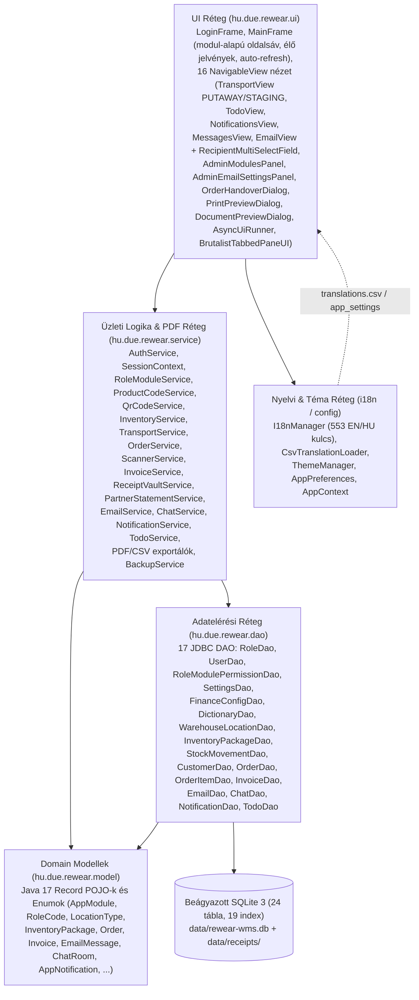
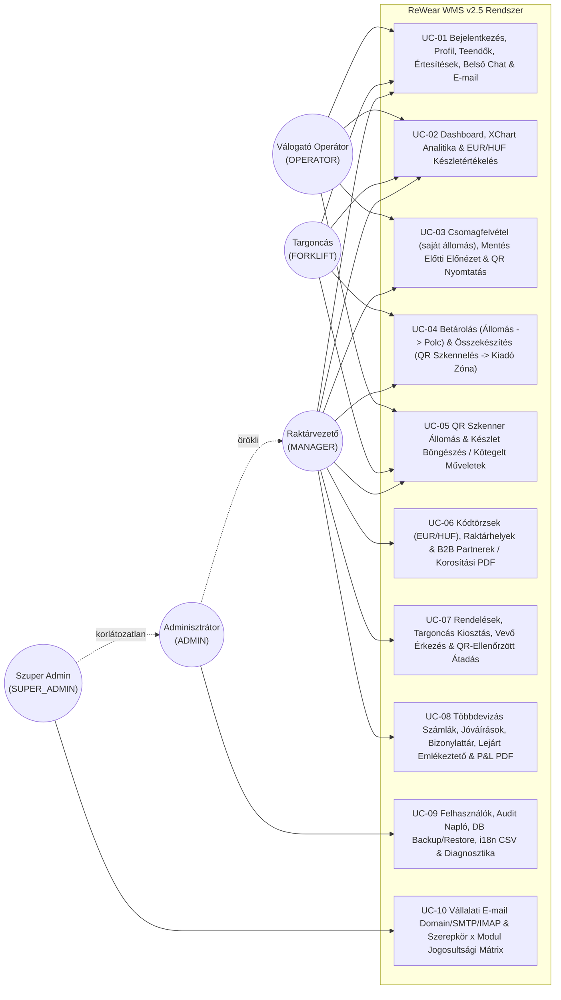
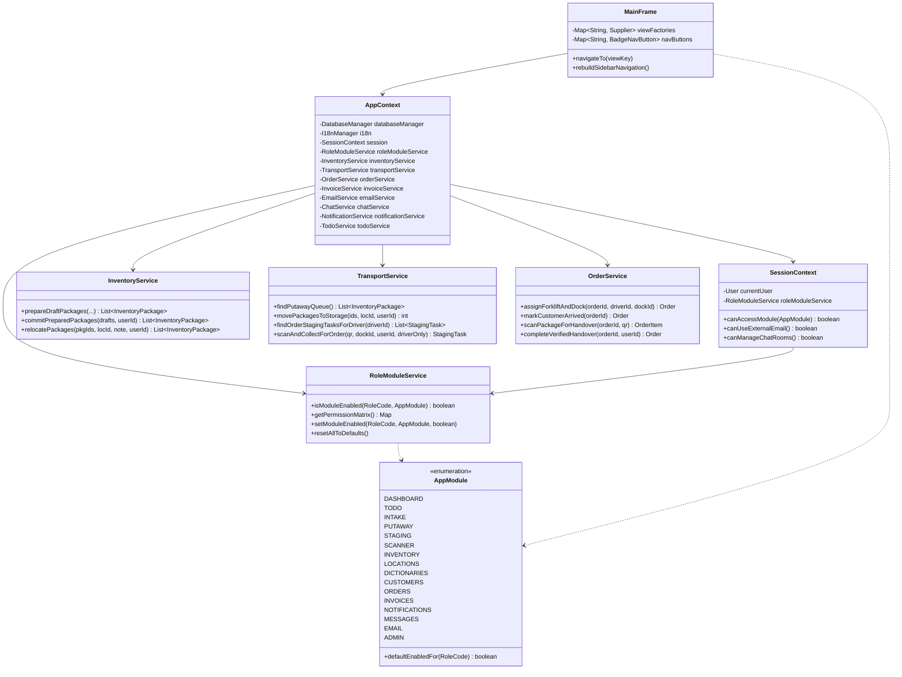
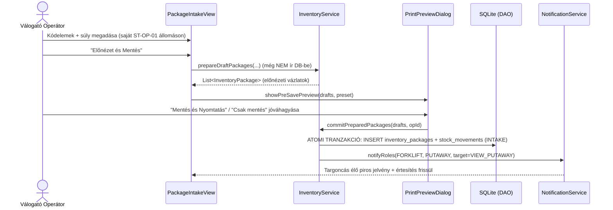
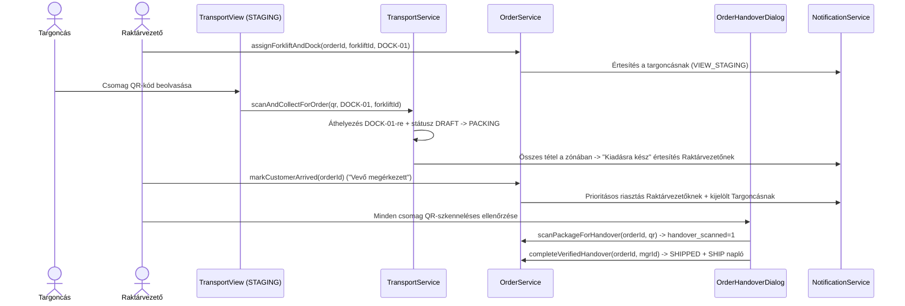

# Programterv — ReWear WMS (`due-prog-03`)

Ez a dokumentum a **ReWear WMS (v2.5)** szoftverarchitektúráját, használati eseteit (Use-Case), UML osztálymodelljét, főbb futásidejű folyamatait (szekvenciadiagramok) és automatizált tesztelési eredményeit mutatja be.

---

## 1. Rétegzett architektúra (Layered MVC)

Az alkalmazás szigorúan elkülönített rétegekre épül a `hu.due.rewear` gyökércsomag alatt (**136 fő Java forrásfájl**, **20 JUnit 5 tesztosztály**, **50 teszt**, 0 `-Xlint:all,-serial` figyelmeztetés):

### Alkalmazott tervezési minták
- **DAO / Repository minta:** Minden SQL lekérdezés paraméterezett `PreparedStatement`-ekkel a `dao` csomagban izolált, és írási tranzakciókban megosztott `Connection` példányt használ (`runInTransaction`).
- **Dependency Container (`AppContext`):** Központi konténer példányosítja és köti össze az adatbázist, a 17 DAO-t, a szolgáltatásokat és az i18n kezelőt.
- **Observer / Listener minta:** `LanguageChangeListener`, `ThemeManager.ThemeChangeListener`, `NotificationService` és `RoleModuleService` változás-figyelők biztosítják a nyelv, téma, élő jelvények és modul-jogosultságok újraindítás nélküli, azonnali frissítését.
- **Strategy / Document Source minta:** A `LabelPreset` enum (`THERMAL_100X150`, `THERMAL_80X100`, `A6_CARD`, `A4_4UP`) vezérli a címkenyomtatást (beleértve a kötelező mentés előtti előnézetet is), a `DocumentPageSource` interfész pedig egységesíti az A4 PDF számlák, jóváíró számlák, szállítólevelek, partner korosítási egyenlegközlők és P&L riportok kezelését.
- **Lazy View Factory & Off-EDT Worker minta:** A `MainFrame` `Supplier<NavigableView>` gyárakkal lustán hozza létre a nézeteket (kirajzolás előtti azonnali `refreshData()` hívással, üres képkocka nélkül), az `AsyncUiRunner` pedig `SwingWorker` segítségével a háttérszálra viszi a 250–300 DPI PDF generálást, CSV exportot, készletszűrést és oldalsáv-jelvény lekérdezéseket.

---

## 2. Use-Case diagram és használati esetek (5 szerepkör)

---

## 3. UML Osztálydiagram (Kiemelt osztályok)

---

## 4. Fő folyamatok szekvenciadiagramjai

### 4.1 Operátori csomagfelvétel kötelező mentés előtti előnézettel és targoncás értesítéssel

### 4.2 Targoncás QR-szkenneléses komissiózás, vevő érkezés és ellenőrzött kiadás

---

## 5. Tesztelési terv és eredmények (JUnit 5)

A rendszer üzleti logikáját, 24 táblás adatbázis-integritását, többdevizás pénzügyi számításait, targoncás és átadási folyamatait, levelezését, belső chatjét, értesítéseit, modul-jogosultsági mátrixát és háttérszálú UI-futtatását **20 tesztosztály, összesen 50 automatizált JUnit 5 teszt** ellenőrzi (0 `-Xlint:all,-serial` fordítási figyelmeztetés):

| Tesztosztály | Tesztek | Ellenőrzött funkcionalitás |
|---|:---:|---|
| `I18nManagerTest` | 5 | EN/HU fordítások, paraméteres formázás, 3. nyelv (`de`) dinamikus CSV betöltése, export/újratöltés, teljes **553 kulcsos** `translations.csv` szerkezeti integritás-ellenőrzés |
| `ProductCodeServiceTest` | 4 | `YYYY-MM-DD-HH-MM-...` konvenció, tizedes súlyok, szegmens-normalizálás, 40 ütközésmentes hex végződés, hibás kódok elutasítása |
| `DatabaseLayerIntegrationTest` | 4 | 24 táblás séma + idempotens demo seed, BCrypt ellenőrzés, egyedi kódtörzsek, `UNIQUE` és `FOREIGN KEY` megszorítások, telítettség és statisztikák |
| `AuthServiceTest` | 4 | Szerepkörök és BCrypt hitelesítés, hibás jelszó / inaktív fiók elutasítása, jelszócsere, hordozható profil- és preferencia-perzisztencia |
| `Wave2MultiLineCreditNoteAndBulkTest` | 4 | Többsoros kézi számlák, 1-kattintásos jóváíró számla (`CN-`), kettős EUR/HUF készletértékelés & P&L PDF, atomi kötegelt áthelyezés |
| `V22CommsAndForkliftWorkflowTest` | 4 | Operátori állomás-korlátozás, előnézet-vázlat vs. végleges mentés, targoncás betárolás/komissiózás, vállalati domain/e-mail + belső-only szabály, Element-stílusú chat szobák & DM |
| `CompanyProfileOverdueAndPricingTest` | 3 | Szerkeszthető eladói cégprofil + devizánkénti IBAN PDF, automatikus `ISSUED → OVERDUE` + `mailto:` emlékeztető, rendelési tételár módosítás |
| `AsyncUiRunnerTest` | 3 | Háttérszálú (off-EDT) futtatás + EDT kézbesítés, kivétel továbbítás, `runLatest` elavult válaszok eldobása |
| `InventoryServiceAndLabelPdfTest` | 2 | Atomi kötegelt csomagfelvétel + áthelyezés + leltári ellenőrzés + magyar nyelvű Thermal 100×150 és A4 4-es PDF címke generálás |
| `ScannerAndOrderServiceTest` | 2 | Szöveges & képfájlos QR szkennelés + teljes rendelési életciklus (`DRAFT` → `PACKING` → `SHIPPED` és `CANCELLED` felszabadítás) |
| `CsvExportAndDictionaryGuardTest` | 2 | UTF-8 BOM magyar készlet és audit napló CSV export, hivatkozott kódtörzs törlésvédelme |
| `InvoiceAndReversibleOrderTest` | 2 | Rendeléshez kapcsolt kimenő számla + kombinált számla/szállítólevél PDF, kiszállított rendelés visszavonása |
| `MultiCurrencyPricingAndPnlTest` | 2 | Ország-alapú adótípus ajánlás (`HU 27%` vs `AT/DE 0%`), elkülönített `EUR`/`HUF`/`USD` főkönyvi P&L összesítés |
| `Wave3ReceiptVaultAndAgingTest` | 2 | Hordozható bizonylattár (`./data/receipts/`), partner korosítási egyenlegközlő (Current / 1–30 / 31–60 / 61–90 / 90+ nap) és A4 PDF |
| `V23NotificationsTodoAndStationTest` | 2 | Automatikus értesítési triggerek, kijelölt operátori állomás zárolás, szerepkör-specifikus rendszer- és személyes teendők |
| `V24OrderHandoverWorkflowTest` | 1 | Targoncáshoz rendelt QR-szkenneléses komissiózás, vevő érkezési értesítés és 100%-os QR-ellenőrzött raktárvezetői kiadás |
| `V25RoleModulePermissionsTest` | 1 | 16 modul alapértelmezett szerepkör-szabályai, Szuper Admin valós idejű ki-/bekapcsolás & visszaállítás, `SUPER_ADMIN` kizárás-védelem, jogosulatlan módosítás tiltása (`SecurityException`) |
| `QrCodeServiceTest` | 1 | ZXing QR generálás → PNG fájl mentés → dekódolás pontos round-trip ellenőrzése |
| `DeliveryNotePdfExporterTest` | 1 | Angol és magyar A4 PDF szállítólevél generálása rendelés QR-kóddal |
| `BackupServiceTest` | 1 | SQLite `VACUUM INTO` biztonsági mentés, visszaállítás, előzetes `.db.bak` mentés, érvénytelen fájl elutasítása |
