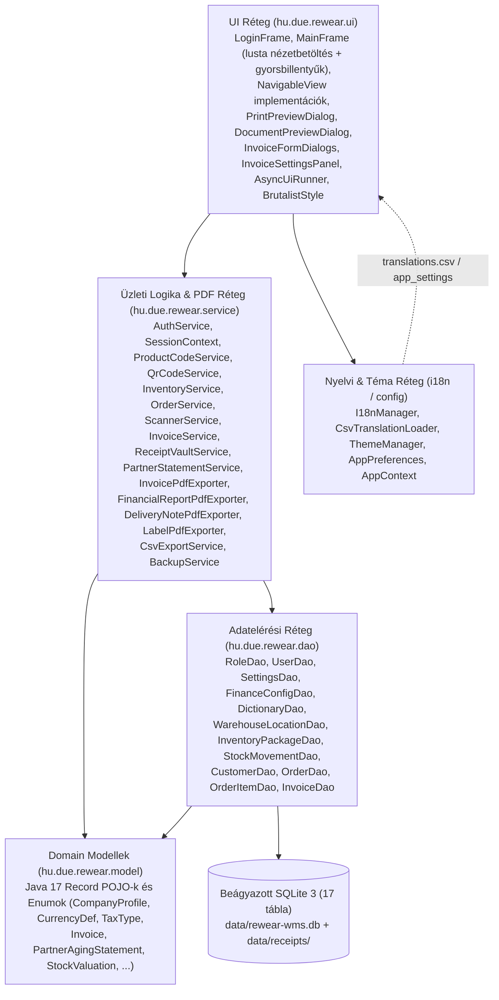
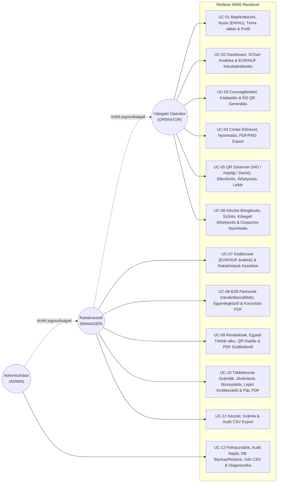
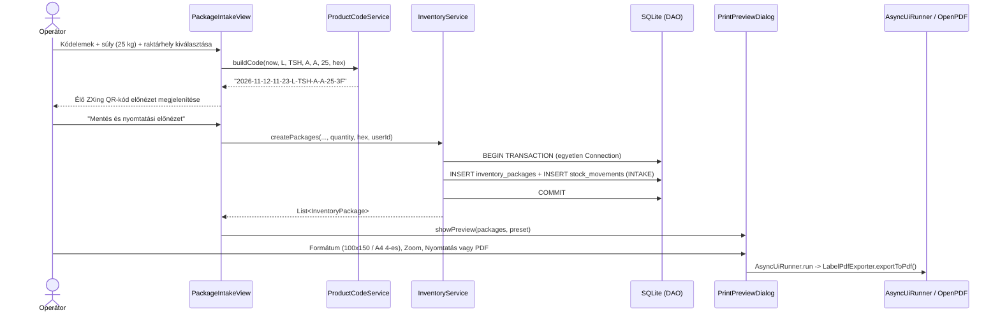
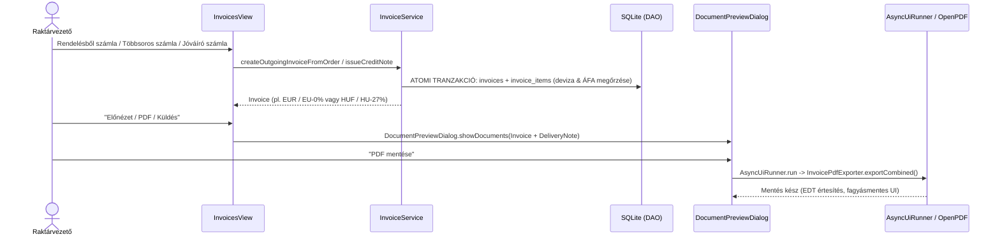

# Programterv — ReWear WMS (`due-prog-03`)

Ez a dokumentum a **ReWear WMS** szoftverarchitektúráját, használati eseteit (Use-Case), UML osztálymodelljét, főbb futásidejű folyamatait (szekvenciadiagramok) és automatizált tesztelési eredményeit mutatja be.

---

## 1. Rétegzett architektúra (Layered MVC)

Az alkalmazás szigorúan elkülönített rétegekre épül a `hu.due.rewear` gyökércsomag alatt (106 fő forrásfájl, 16 JUnit 5 tesztosztály):

### Alkalmazott tervezési minták
- **DAO / Repository minta:** Minden SQL lekérdezés paraméterezett `PreparedStatement`-ekkel a `dao` csomagban izolált, és írási tranzakciókban megosztott `Connection` példányt használ (`executeInTransaction`).
- **Dependency Container (`AppContext`):** Központi konténer példányosítja és köti össze az adatbázist, a 12 DAO-t, a szolgáltatásokat és az i18n kezelőt.
- **Observer / Listener minta:** `LanguageChangeListener` és `ThemeManager.ThemeChangeListener` biztosítja az azonnali, újraindítás nélküli nyelv- és témaváltást (EN/HU/egyedi CSV nyelv, Brutalist Világos/Sötét).
- **Strategy / Document Source minta:** A `LabelPreset` enum (`THERMAL_100X150`, `THERMAL_80X100`, `A6_CARD`, `A4_4UP`) vezérli a címkenyomtatást, a `DocumentPageSource` interfész pedig egységesíti az A4 PDF számlák, jóváíró számlák, szállítólevelek, partner korosítási egyenlegközlők és P&L riportok előnézetét, nyomtatását, PDF-exportját és e-mail csatolását a `DocumentPreviewDialog`-ban.
- **Lazy View Factory & Off-EDT Worker minta:** A `MainFrame` `Supplier<NavigableView>` gyárakkal lustán hozza létre a nézeteket, az `AsyncUiRunner` pedig `SwingWorker` segítségével a háttérszálra viszi a 250–300 DPI PDF generálást, CSV exportot és szűrést (generáció-követéssel a `runLatest` hívásokhoz).

---

## 2. Use-Case diagram és használati esetek

---

## 3. UML Osztálydiagram (Kiemelt osztályok)

```mermaid
classDiagram
    class AppContext {
        -DatabaseManager databaseManager
        -I18nManager i18n
        -SessionContext session
        -ProductCodeService productCodeService
        -QrCodeService qrCodeService
        -InventoryService inventoryService
        -OrderService orderService
        -ScannerService scannerService
        -InvoiceService invoiceService
        -ReceiptVaultService receiptVaultService
        -PartnerStatementService partnerStatementService
        -BackupService backupService
    }

    class I18nManager {
        -TranslationBundle bundle
        -String activeLanguage
        +getAvailableLanguages() List~String~
        +setLanguage(lang)
        +t(key, args) String
        +loadFromFile(Path)
        +exportToFile(Path)
    }

    class ProductCodeService {
        +generateHexSuffix() String
        +normalizeCodeSegment(raw) String
        +buildCode(ts, target, type, quality, pkg, weight, hex) String
        +generateUniqueCode(..., existsCheck) String
        +parse(rawCode) Optional~ParsedProductCode~
    }

    class InventoryService {
        +createPackages(...) List~InventoryPackage~
        +relocatePackage(pkgId, locId, note, userId) InventoryPackage
        +relocatePackages(pkgIds, locId, note, userId) List~InventoryPackage~
        +verifyStocktake(pkgId, note, userId)
        +discardPackage(pkgId, note, userId) InventoryPackage
    }

    class OrderService {
        +createOrder(customerId, currency, userId) Order
        +addPackageToOrder(orderId, pkgId, price, userId) Order
        +updateOrderItemPrice(orderId, itemId, newPrice) Order
        +shipOrder(orderId, userId) Order
        +cancelOrder(orderId, userId) Order
    }

    class InvoiceService {
        +createOutgoingInvoiceFromOrder(...) Invoice
        +createMultiLineManualInvoice(...) Invoice
        +issueCreditNote(sourceInvoiceId, userId) Invoice
        +syncOverdueStatuses() int
        +buildPaymentReminderMailtoUri(inv, company, i18n) String
        +computeSummary(invoices) FinancialSummary
    }

    class ReceiptVaultService {
        +attachReceipt(invoiceId, sourceFile) Invoice
        +resolveAttachment(inv) Optional~Path~
        +removeAttachment(invoiceId) void
    }

    class PartnerStatementService {
        +buildStatement(partner, asOf) PartnerAgingStatement
        +createStatementPageSource(stmt, company) DocumentPageSource
    }

    class DocumentPageSource {
        <<interface>>
        +getDocumentId() String
        +getDisplayTitle() String
        +getDefaultFileName() String
        +getPageCount() int
        +paintPage(Graphics2D, page, w, h)
    }

    class AsyncUiRunner {
        +run(owner, work, onSuccess, onError)
        +runLatest(key, owner, work, onSuccess, onError)
    }

    class NavigableView {
        <<interface>>
        +getViewKey() String
        +getTitleI18nKey() String
        +getComponent() JComponent
        +refreshData()
        +applyTranslations()
        +applyTheme()
    }

    class MainFrame {
        -Map~String, Supplier~ viewFactories
        -Map~String, NavigableView~ views
        +navigateTo(viewKey)
        +onLanguageChanged(lang)
        +onThemeChanged(dark)
    }

    AppContext --> I18nManager
    AppContext --> ProductCodeService
    AppContext --> InventoryService
    AppContext --> OrderService
    AppContext --> InvoiceService
    AppContext --> ReceiptVaultService
    AppContext --> PartnerStatementService
    PartnerStatementService ..> DocumentPageSource
    MainFrame --> AppContext
    MainFrame o-- NavigableView
    MainFrame ..> AsyncUiRunner
```

---

## 4. Fő folyamatok szekvenciadiagramjai

### 4.1 Csomagfelvétel, élő QR-kód generálás és címkenyomtatás

### 4.2 Többdevizás számlázás, jóváírás és háttérszálú PDF export

---

## 5. Tesztelési terv és eredmények (JUnit 5)

A rendszer üzleti logikáját, adatbázis-integritását, többdevizás pénzügyi számításait, fájlkezelését, PDF/QR generálását és háttérszálú UI-futtatását **16 tesztosztály, összesen 42 automatizált JUnit 5 teszt** ellenőrzi (0 `-Xlint:all,-serial` fordítási figyelmeztetés):

| Tesztosztály | Tesztek | Ellenőrzött funkcionalitás |
|---|:---:|---|
| `I18nManagerTest` | 5 | EN/HU fordítások, paraméteres formázás, 3. nyelv (`de`) dinamikus CSV betöltése, veszteségmentes export/újratöltés, teljes 400 kulcsos `translations.csv` szerkezeti integritás-ellenőrzés |
| `ProductCodeServiceTest` | 4 | `YYYY-MM-DD-HH-MM-...` konvenció, tizedes súlyok, egyedi szegmens-normalizálás, 40 ütközésmentes hex végződés, hibás kódok elutasítása |
| `DatabaseLayerIntegrationTest` | 4 | 17 táblás séma + idempotens demo seed, BCrypt ellenőrzés, egyedi kódtörzsek, `UNIQUE` és `FOREIGN KEY` megszorítások, telítettség és statisztikák |
| `AuthServiceTest` | 4 | `ADMIN` / `MANAGER` / `OPERATOR` RBAC mátrix, hibás jelszó és inaktív fiók elutasítása, jelszócsere, hordozható profil- és preferencia-perzisztencia |
| `Wave2MultiLineCreditNoteAndBulkTest` | 4 | Többsoros kézi számlák, 1-kattintásos jóváíró számla (`CN-`), kettős EUR/HUF készletértékelés & P&L PDF generálás, atomi kötegelt csomag-áthelyezés |
| `CompanyProfileOverdueAndPricingTest` | 3 | Szerkeszthető eladói cégprofil + devizánkénti IBAN PDF-megjelenítés, automatikus `ISSUED → OVERDUE` átmenet & `mailto:` emlékeztető, rendelési tételár módosítás |
| `AsyncUiRunnerTest` | 3 | Háttérszálú (off-EDT) futtatás + EDT válasz-kézbesítés, kivétel továbbítása az `onError` kezelőnek, `runLatest` elavult eredmények eldobása |
| `InventoryServiceAndLabelPdfTest` | 2 | Atomi kötegelt csomagfelvétel + áthelyezés + leltári ellenőrzés + magyar nyelvű Thermal 100×150 és A4 4-es PDF címke generálás |
| `ScannerAndOrderServiceTest` | 2 | Szöveges & képfájlos QR szkennelés összes állapota + teljes rendelési életciklus (`DRAFT` → `PACKING` → `SHIPPED` és `CANCELLED` készlet-felszabadítás) |
| `CsvExportAndDictionaryGuardTest` | 2 | UTF-8 BOM magyar készlet és audit napló CSV export, hivatkozott kódtörzs törlésvédelme |
| `InvoiceAndReversibleOrderTest` | 2 | Rendeléshez kapcsolt kimenő számla + kombinált számla/szállítólevél PDF, kiszállított rendelés visszavonása |
| `MultiCurrencyPricingAndPnlTest` | 2 | Ország-alapú adótípus ajánlás (`HU 27%` vs `AT/DE 0%`), elkülönített `EUR`/`HUF`/`USD` főkönyvi P&L összesítés átváltás nélkül |
| `Wave3ReceiptVaultAndAgingTest` | 2 | Hordozható bizonylattár (`./data/receipts/` csatolás/csere/törlés), partner korosítási egyenlegközlő (Current / 1–30 / 31–60 / 61–90 / 90+ nap) és A4 PDF generálás |
| `QrCodeServiceTest` | 1 | ZXing QR generálás → PNG fájl mentés → dekódolás pontos round-trip ellenőrzése |
| `DeliveryNotePdfExporterTest` | 1 | Angol és magyar A4 PDF szállítólevél generálása rendelés QR-kóddal |
| `BackupServiceTest` | 1 | SQLite `VACUUM INTO` biztonsági mentés, visszaállítás, előzetes `.db.bak` mentés, érvénytelen fájl elutasítása |
